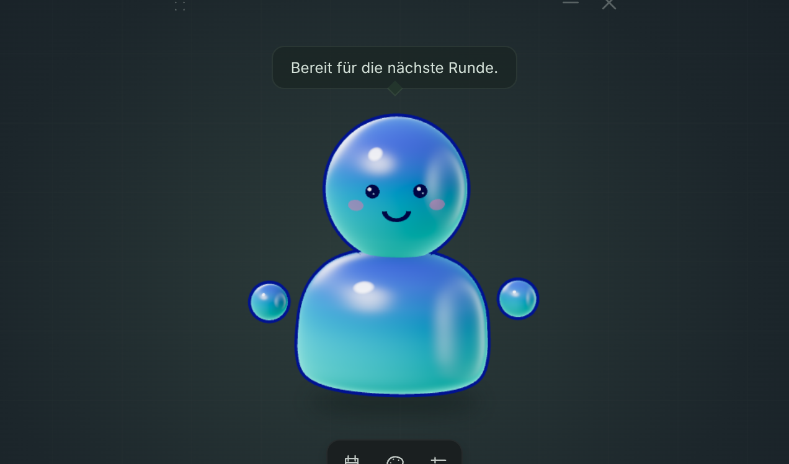

# LAN Desk Pet

Ein kleiner Desktop-Begleiter für die LAN am Umwelt-Campus Birkenfeld im November
2026. Ein minimalistisches 3D-Pet schwebt über einer kompakten Glas-Leiste. Essen,
Getränke und Events werden auf Vertrauensbasis selbst gemeldet.

Der erste Prototyp ist eine **Tauri-Desktop-App mit Rust-Backend** und einer
**React-/TypeScript-Oberfläche mit React Three Fiber und Three.js**. Die 3D-Figur
ist ein austauschbarer Platzhalter mit einem eigenen Toon-Shader.

## Starten

Benötigt: Node.js 24 LTS mit npm, aktuelles Rust stable sowie die
[Tauri-Systemvoraussetzungen](https://v2.tauri.app/start/prerequisites/).
Unter Windows sind insbesondere MSVC-Buildtools und WebView2 nötig. Linux
benötigt unter anderem WebKitGTK 4.1 und die in der Tauri-Dokumentation für die
jeweilige Distribution aufgeführten Entwicklungspakete. macOS benötigt Xcode
Command Line Tools.

```sh
npm ci
npm run tauri dev
```

Das öffnet das transparente Desktop-Pet. Über die Punkte oben links wird es
verschoben; oben rechts lässt es sich minimieren oder schließen. Eine minimierte
App lässt sich über die Taskleiste wieder aufrufen.

Falls dein Node-Versionsmanager noch keine aktive Version hat, aktiviere zuerst
Node 24; die getestete Version steht in `.nvmrc`. Für diesen Aufbau wurde die
bereits installierte Node-Laufzeit direkt verwendet, ohne die globale
Versionsmanager-Konfiguration zu verändern.

Die npm-Befehle für Tauri und Rust ergänzen für ihre Unterprozesse automatisch
`$CARGO_HOME/bin` beziehungsweise `~/.cargo/bin`. Damit funktioniert eine bereits
installierte Rustup-Toolchain auch dann, wenn ein noch offenes Terminal oder
Codex den bei der Installation ergänzten Suchpfad noch nicht übernommen hat.
Die globale PATH-Konfiguration wird dabei nicht verändert. Direkte Rust-Befehle
lassen sich über `npm run rust -- <Cargo-Argumente>` ausführen.

Nur die Oberfläche im Browser ansehen:

```sh
npm run dev
```

Die Vorschau liegt unter [localhost:1420](http://127.0.0.1:1420). Dort lassen sich
die Panels und das Aussehen ausprobieren. **XP-Aktionen und Speicherung laufen
ausschließlich im nativen Rust-Backend** und sind im Browser deaktiviert.

## Im Prototyp enthalten

- Transparentes, rahmenloses, verschiebbares Fenster, stets im Vordergrund.
- Animiertes Low-Poly-Pet mit Toon-Shader; drei Farben und ein eigener Name.
- Kleine Glas-Leiste mit LAN-Aktionen, Anpassung und Einstellungen.
- Essen: +15 XP, Getränk: +10 XP, Event: +30 XP; je 100 XP ein Level.
- Pet-Klicks und Tasten im fokussierten Pet-Fenster: +1 XP, maximal einmal pro
  Sekunde. Eingaben in Formularen und auf Bedienelementen werden nicht gezählt.
- Lokaler Spielstand in `pet.json` im plattformspezifischen App-Datenverzeichnis
  für `de.ucb.lan-desk-pet`. Rust validiert den Zustand und ersetzt die Datei
  erst nach einem vollständigen Schreibvorgang. Fehler werden im Pet angezeigt;
  defekte oder unbekannte Dateiformate werden nicht still zurückgesetzt.
- Eine zweite gestartete Instanz aktiviert das vorhandene Pet, damit nicht zwei
  unabhängige Prozesse denselben Spielstand überschreiben.
- Animation mit etwa 30 Bildern pro Sekunde, begrenzter Pixeldichte und Pause
  bei verborgenem WebView. Die Option „Weniger Bewegung“ und die entsprechende
  Systemeinstellung reduzieren die Animation auf eine statische Darstellung.

## Aufbau

```text
src/
  App.tsx          Pet-Menü, Aktionen und Tauri-Aufrufe
  PetScene.tsx     3D-Platzhalter, Shader und Animationsschleife
  pet.ts           Frontend-Datentypen und Levelanzeige
  styles.css       Transparenz, Leiste, Panels und Browser-Vorschau
src-tauri/
  src/lib.rs       Tauri-Befehle und serialisierter Zugriff auf den Spielstand
  src/pet.rs       Rust-Spielmodell, XP, Validierung und Speicherung
  src/pet/tests.rs Backend-Tests mit isolierten temporären Spielständen
  tauri.conf.json  Desktop-Fenster und Content Security Policy
  capabilities/   Berechtigungen für Fensterbedienung
```

Die Oberfläche übermittelt nur die Aktion oder die Anpassung an Rust; sie kann
keinen beliebigen XP-Wert oder Dateipfad setzen. Es gibt keine Accounts, keinen
Server und keine externe Kauf- oder Veranstaltungsprüfung.

## Prüfen und bauen

```sh
npm test
npm run test:rust
npm run build
npm run rust -- fmt --manifest-path src-tauri/Cargo.toml --check
npm run rust -- clippy --manifest-path src-tauri/Cargo.toml --all-targets -- -D warnings
npm run tauri build -- --debug --no-bundle
```

Der letzte Befehl erstellt einen nativen Debug-Build, unter Windows in
`src-tauri/target/debug/lan-desk-pet.exe`. Installer, Signierung und Updates sind
noch nicht konfiguriert. `npm run check` kombiniert die Frontend-Tests, den
Frontend-Build und die Rust-Tests.

## Bewusste Grenzen und nächste Schritte

1. **Aktivität während des Spielens:** Systemweite Eingaben sind noch nicht
   angebunden. Zunächst eine optionale Windows-Integration und die Möglichkeiten
   unter Linux/X11 und Wayland separat prüfen. Es sollen Aktivitätszähler an das
   Pet gehen, keine Tasteninhalte. Kompatibilität mit Spielen und Anti-Cheat muss
   praktisch getestet werden.
2. **Desktop-Verhalten:** Transparente Stellen im rechteckigen Fenster sind noch
   nicht durchklickbar. Position und Fenstergröße werden noch nicht gespeichert.
   Always-on-top garantiert keine Sichtbarkeit über exklusivem Vollbild. Linux
   und macOS brauchen eigene Tests auf echter Hardware.
3. **Charakter und Fortschritt:** Den Platzhalter gemeinsam gestalten, dann
   Reaktionen und kleine Belohnungen passend zur LAN festlegen. Die aktuellen
   XP-Werte sind Prototypwerte. Noch keine Hunger-/Durstsimulation.

WebGL ist vorerst die Rendering-Basis, damit WebGPU keine Startvoraussetzung ist.
Ein späterer WebGPU-Renderer benötigt auch eine passende Portierung des
GLSL-Shaders. CSS-Glas ist umgesetzt; echte Unschärfe des Desktop-Wallpapers ist
plattformabhängig und noch nicht integriert. Für transparente macOS-Fenster ist
Tauris Private-API-Option aktiviert; das schließt eine Mac-App-Store-Veröffentlichung
in dieser Form aus.



Design und erster Arbeitsplan liegen in `docs/superpowers/`.
