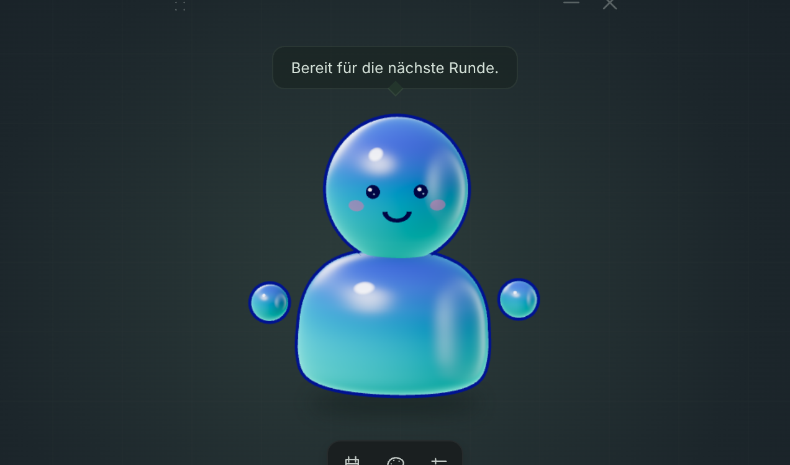

# Jelly

Ein kleiner Desktop-Begleiter für die LAN am Umwelt-Campus Birkenfeld im November 2026. Ein
minimalistisches 3D-Pet schwebt über einer kompakten Glas-Leiste. Essen und Getränke werden auf
Vertrauensbasis selbst gemeldet, Events per Code. Über XP entscheidet der Jelly-Server
(`apps/server`).

Der erste Prototyp ist eine **Tauri-Desktop-App mit Rust-Backend** und einer
**React-/TypeScript-Oberfläche mit React Three Fiber und Three.js**. Die 3D-Figur ist ein
austauschbarer Platzhalter mit eigenen Shadern.

## Starten

Benötigt: Node.js 24 LTS mit pnpm (Monorepo-Root `joint`), aktuelles Rust stable sowie die
[Tauri-Systemvoraussetzungen](https://v2.tauri.app/start/prerequisites/). Unter Windows sind
insbesondere MSVC-Buildtools und WebView2 nötig. Linux benötigt unter anderem WebKitGTK 4.1 und die
in der Tauri-Dokumentation für die jeweilige Distribution aufgeführten Entwicklungspakete. macOS
benötigt Xcode Command Line Tools.

```sh
pnpm install
pnpm run tauri dev
```

`pnpm install` läuft im Monorepo-Root, die übrigen Befehle in `apps/client`.

Das öffnet das transparente Desktop-Pet. Über die Punkte oben links wird es verschoben; oben rechts
lässt es sich minimieren oder schließen. Eine minimierte App lässt sich über die Taskleiste wieder
aufrufen.

Falls dein Node-Versionsmanager noch keine aktive Version hat, aktiviere zuerst Node 24; die
getestete Version steht in `.nvmrc` im Monorepo-Root.

Die pnpm-Skripte für Tauri und Rust ergänzen für ihre Unterprozesse automatisch `$CARGO_HOME/bin`
beziehungsweise `~/.cargo/bin`. Damit funktioniert eine bereits installierte Rustup-Toolchain auch
dann, wenn ein noch offenes Terminal den bei der Installation ergänzten Suchpfad noch nicht
übernommen hat. Die globale PATH-Konfiguration wird dabei nicht verändert. Direkte Rust-Befehle
lassen sich über `pnpm run rust -- <Cargo-Argumente>` ausführen.

Nur die Oberfläche im Browser ansehen:

```sh
pnpm run webpreview:dev
```

Die Vorschau liegt unter [localhost:1420](http://127.0.0.1:1420). Dort lassen sich die Panels und
das Aussehen mit Beispieldaten ausprobieren. **Konto, XP-Aktionen und Speicherung laufen
ausschließlich über das native Rust-Backend** und sind im Browser deaktiviert.

## Server

Die App braucht einen laufenden Jelly-Server. Rust spricht mit ihm über HTTP und hält das Secret,
die Oberfläche bekommt nur den fertigen Stand. Die Adresse steht beim Bauen fest:

```sh
JELLY_SERVER_URL=https://jelly.example.org pnpm run tauri build   # ohne Angabe: http://localhost:8080
```

Für die Entwicklung einen lokalen Server mit laufender LAN starten (in `apps/server`):

```sh
export JELLY_DB=/tmp/jelly.db JELLY_STAGE_KEY=buehne JELLY_ADMIN_SECRET=admin
JELLY_JOIN_CODE=1234 go run ./cmd/jelly-server create-lan -slug test -name Test-LAN \
  -from 2026-11-01T00:00:00+01:00 -to 2026-11-30T00:00:00+01:00
go run ./cmd/jelly-server
```

Danach `pnpm run tauri dev`: Die App fragt nach Name, Farbe und dem gemeinsamen Code `1234`. Sitzplatz-Codes
vergibt der Admin, sie gelten einmal. Beim Start prüft sie
`GET /version` und bittet um ein Update, wenn der Server eine neuere App verlangt.

## Im Prototyp enthalten

- Transparentes, rahmenloses, verschiebbares Fenster, stets im Vordergrund.
- Animiertes Jelly-Pet mit Raymarching-Shader; drei Farben und ein eigener Name.
- Cosmetics zum Freischalten über Level, Erfolge und Events. Die 3D-Modelle kommen aus der
  Blender-Pipeline in `blender/`; im Repository liegen noch keine.
- Kleine Glas-Leiste mit LAN-Aktionen, Studio und Einstellungen.
- Studio direkt am Pet: Tropfen auf Kopf, Gesicht, Effekten und Körper öffnen flüssige Popovers für
  Cosmetics und Farbe. Sie brechen das Bild dahinter und schillern am Rand wie eine Seifenblase. Die
  Kamera fährt zur Region, das Namensschild unter den Füßen ist das Eingabefeld. Jede Wahl gilt
  sofort.
- Ein Code der Orga bringt ein neues Konto, holt ein vorhandenes zurück oder setzt es auf einen Platz
  der laufenden LAN (`POST /v1/auth/redeem`). Danach zählt nur das Secret, ein älteres gilt nicht mehr.
- Cosmetics liegen auf Plätzen, je Platz eines (`PUT /v1/cosmetics/equipped`). Die App zeigt die Plätze
  Kopf, Gesicht und Aura. Einfärbbare Cosmetics bekommen vorerst die erste Farbe der Palette.
- XP, Level, Cosmetics und Erfolge kommen vom Server. Mit seinen Standardregeln: Stupser +3 XP alle
  15 Minuten, Essen +15 XP, Getränk +10 XP, Event-Codes nach Vorgabe der Orga; je 100 XP ein Level.
  Die App fragt nur beim Server, wenn ein Stupser wieder etwas bringt.
- Über den Emote-Tropfen rechts am Jelly lassen sich Winken, Tanzen, Jubeln, Lachen, Schlafen
  und Herz auswählen. Nach Bestätigung durch `POST /v1/emotes` spielt das Jelly die Geste für drei
  Sekunden. Die Bühne nutzt dieselben Gesten aus `@jelly/scene`; reduzierte Bewegung zeigt eine
  ruhige Pose. In der Browser-Vorschau funktionieren die Gesten ohne Server und ohne Fortschritt.
  Escape und ein Klick außerhalb schließen die Auswahl, ohne das Jelly anzustupsen.
- Emotes anderer Geräte werden lokal nicht wiedergegeben. Der eigene Aufruf startet die Geste
  genau einmal, auch wenn das Jelly von der Orga ausgeblendet ist. Bei einem Netzfehler wird nur
  der Stand neu geladen: Der Server könnte das Emote bereits angenommen haben.
- Der Schild-Tropfen links unten am Jelly öffnet eine Säule aus flüssigen Glas-Kapseln mit den
  Schildern des Servers. Beim Überfahren zeigt das Jelly das Schild zur Probe auf seiner Tafel, nur
  lokal. Die Wahl geht per `PUT /v1/signs/current` raus: Das Jelly hält die Tafel quer vor dem Bauch, und auf
  der Bühne erscheint das Schild über seinem Kopf. Ein Klick auf das gewählte Schild senkt es
  (`DELETE /v1/signs/current`). Im Studio legt das Jelly die Tafel kurz weg. Schilder gibt es nur während einer
  LAN, in der Browser-Vorschau auch ohne Server.
- Der Dock-Knopf „Dabei“ öffnet zwei Reiter. „Dazustellen“ listet die anderen anwesenden Jellies (`GET /v1/stage`). Ein Klick
  lässt das eigene Jelly auf der Bühne zum gewählten laufen (`POST /v1/trips/follow`), ein zweiter Klick
  oder „Weggehen“ beendet das (`DELETE /v1/trips/current`). Die Lupe öffnet ein Suchfeld, das die Liste
  nach Namen filtert. `follow.changed` lädt den Stand neu. Nach `follow_until` endet das Dazustellen von
  selbst, ohne Ereignis: Dann liest die App ihren Stand von sich aus neu. Die Browser-Vorschau zeigt zwei
  Beispiel-Jellies.
- Der Karten-Tropfen rechts unten am Jelly öffnet die Halle mit allen Jellies in einem eigenen Fenster,
  dieselbe 3D-Bühne wie auf dem Beamer (`@jelly/stage`, Daten aus `GET /v1/stage`). Wo die Jellies laufen,
  plant der Server, die Karte spielt seine Wege nur ab (`moves`, Nachricht `move` im Stream). Das eigene Jelly trägt seine
  Farbe im Namen und eine Markierung über dem Kopf, sein Ziel eine weiße. Unter dem Zeiger zeigt jedes
  Jelly seinen Namen, auch im Gedränge. Ein Klick stellt das eigene Jelly dazu, ein zweiter Klick auf
  das Ziel oder „Weggehen“ beendet das. Das Pet reagiert darauf wie bei der Liste, auch wenn der Server
  das Dazustellen beendet. Die Karte kostet Grafikleistung nur, solange sie offen ist, sie rechnet ohne
  die doppelte Auflösung des Beamers und schließt sich mit dem Pet. Solange sie offen ist, ist das Pet
  versteckt, danach kommt es zurück. Das Fenster hat keinen Rahmen des Systems: Griff, Minimieren und
  Schließen zeichnet die Seite selbst, das Bild läuft zum Rand hin in die Farbe des Bodens aus. „Weggehen“
  ist ein Tropfen aus demselben flüssigen Glas wie am Jelly, in dessen Farbe. Die Browser-Vorschau zeigt
  die Halle der Server-Demo.
- Der Reiter „Partner-Emote“ im selben Panel fordert ein anderes Jelly auf (`POST /v1/partner-emotes`):
  Erst die Geste wählen, dann das Jelly aus der Liste der Bühne. Wer zu weit weg steht, erfährt es vom
  Server (`409 too_far`). Die Aufforderung steht in einer Stoppuhr, deren Ring leer läuft und im letzten
  Viertel drängt, „Abbrechen“ zieht sie zurück. Das andere Jelly bekommt über dem Dock ein Pop-up
  (`partner_emote.updated`) und nimmt an oder lehnt ab (`PATCH /v1/partner-emotes`). Sobald die Geste
  startet, schließt sich das Panel, denn es verdeckt Jelly und Sprechblase. Der Auffordernde erfährt
  davon aus dem Stream (`partner.emote` mit seiner ID als `partner_id`), die XP kommen als `xp.gained`
  hinterher. Auf beiden Bildschirmen hüpft dann das Jelly des anderen von links herein, beide teilen
  sich den Platz, machen die Geste abwechselnd und singen dazu, das eigene Jelly oben, der Partner
  tiefer, und es hüpft wieder hinaus. Farbe und Cosmetics kommen aus `GET /v1/stage`. Ohne sie tanzt das
  eigene Jelly allein. Die Tropfen am Jelly sind solange weg, sie kreisten sonst mit. In der
  Browser-Vorschau nimmt Wabbel nach zwei Sekunden an, Glibber fragt zurück, so ist das Pop-up zu sehen.
- Die Sprechblase ist flüssiges Glas wie die Tropfen. Neuer Text federt auf und erscheint Silbe für
  Silbe, in Panels und im Studio ist sie weg.
- Das Jelly hat eine eigene Synth-Stimme aus WebAudio, ohne Samples. Es singt die Vokale seiner Sätze
  als kleine Melodie und zeigt dabei je Vokal eine andere Mundform, wie beim Lipsync im Zeichentrick.
  Hüpfer, jede Geste und der Levelaufstieg haben eigene Laute. Vor dem ersten Klick oder Tastendruck
  bleibt es still. In den Einstellungen lässt sich das unter „Geräusche“ abschalten oder per Regler
  leiser stellen, der Mund bewegt sich dann weiter. Bei reduzierter Bewegung lächelt das Jelly nur.
- Ereignisse vom Server (neue XP, Erfolge, Auszeichnungen) kommen per Stream und lösen eine
  Sprechblase aus. Alle 5 Minuten meldet die App, dass sie noch läuft.
- Lokal in `jelly.json` im App-Datenverzeichnis für `de.ucb.jelly` liegen nur Secret, Größe,
  „Weniger Bewegung“, „Geräusche“ und Lautstärke. Rust ersetzt die Datei erst nach einem vollständigen Schreibvorgang. Defekte
  oder unbekannte Dateiformate werden nicht still zurückgesetzt, und das Secret wird nie wegen eines
  Netzfehlers gelöscht.
- Eine zweite gestartete Instanz aktiviert das vorhandene Pet, damit nicht zwei unabhängige Prozesse
  denselben Spielstand überschreiben.
- Animation mit etwa 30 Bildern pro Sekunde, begrenzter Pixeldichte und Pause bei verborgenem
  WebView. Die Option „Weniger Bewegung“ und die entsprechende Systemeinstellung reduzieren die
  Animation auf eine statische Darstellung.

> **Alte Spielstände:** Vor der Server-Anbindung rechnete die App XP lokal in `pet.json`. Diese Datei
> bleibt unberührt, ihr Fortschritt lässt sich aber nicht auf den Server übertragen.

> **Umbenennung:** Bis Ende Oktober 2026 hieß die App „LAN Desk Pet“ mit dem Identifier
> `de.ucb.lan-desk-pet`. Spielstände von damals liegen weiter im alten App-Datenverzeichnis und
> werden nicht übernommen. Wer einen behalten will, kopiert die alte `pet.json` in das neue
> Verzeichnis.

## Aufbau

```text
src/
  main.tsx            Einstieg: Desktop oder Browser-Vorschau, React starten
  App.tsx             Fenster zusammenstecken: Knöpfe, Bühne, Panel, Dock
  backend.ts          einziger Ort mit Tauri-Aufrufen, ein Wrapper je Rust-Befehl
  usePet.ts           Hooks: Spielstand, Aktionen, Tastatur-Stupser, Größen-Regler
  useGame.ts          Hooks: Stand halten, Aufrufe, Server-Ereignisse, Lebenszeichen
  useSigns.ts         Hook: Schild heben und senken
  useFollow.ts        Hook: zu einem anderen Jelly stellen, Liste der Bühne
  usePartnerEmote.ts  Hook: Jelly zum Partner-Emote auffordern und auf Aufforderungen antworten
  useStagePopover.ts  Hook: Auswahlen am Jelly schließen, Fokus halten
  useJellyVoice.ts    Hook: was das Jelly gerade sagt und welcher Laut erklingt
  voice.ts            Synthesizer der Stimme (WebAudio)
  WindowChrome.tsx    Fensterknöpfe, Kopf- und Fußzeile der Vorschau
  Studio.tsx          Anpassen direkt am Jelly: Blobs, Popovers, Namensschild
  studio/             Bausteine des Studios (Blob, Popover, Namensschild)
  SignPicker.tsx      Schild-Tropfen und Kapsel-Säule
  MapDrop.tsx         Karten-Tropfen
  map/                Karte im eigenen Fenster (map.html), ohne React: Seite, Daten, Vorschau
  pet/                reine Logik ohne React (spiegelt Server-Vertrag und src-tauri/src/pet.rs)
  panels/             Inhalte der Glas-Panels (Beitritt, XP und Dabei mit Reitern, Level, Einstellungen)
  scene/              3D: Canvas, Kamera, Anker und Glas des Studios, Pet, Cosmetics und Schild-Tafel;
                      Jelly und Animation aus packages/jelly-scene
    shaders/          GLSL der Cosmetics (Toon, Outline) und des Studio-Glases, per `?raw` importiert
  ui/                 Design-System-Bausteine (siehe `pnpm ds:bundle`)
  cosmetics/          3D-Modelle (.glb) aus Blender, nach Cosmetic-ID benannt
  styles.css          Transparenz, Leiste, Panels und Browser-Vorschau
  studio.css          Knöpfe und Vorlagen des Studios
  signs.css           Schild-Tropfen und Kapsel-Säule
src-tauri/
  src/main.rs         Desktop-Einstieg, ruft nur jelly_lib::run()
  src/lib.rs          App zusammensetzen: Plugins, State, Befehle
  src/commands.rs     Tauri-Befehle, die die Oberfläche aufruft
  src/commands/session.rs  Sitzung und Spielstand zwischen den Befehlen
  src/api.rs          HTTP-Client und Weitergabe der Server-Typen
  src/api/types.rs    Typen aus dem Server-Vertrag
  src/events.rs       Ereignis-Stream des Servers an die Oberfläche weiterleiten
  src/map.rs          Fenster der Karte öffnen und schließen
  src/error.rs        alle Fehler mit deutscher Meldung für die Oberfläche
  src/pet.rs          lokaler Stand und reine Regeln, ohne Dateizugriff und Netz
  src/store.rs        lokalen Stand atomar laden und speichern
  tauri.conf.json     Desktop-Fenster und Content Security Policy
  capabilities/       Berechtigungen je Fenster: Fensterbedienung und Server-Ereignisse
blender/              Cosmetic-Pipeline und Referenzkörper für Blender
scripts/              Hilfsskripte (Rust-Pfad, Design-System-Bundle, Blender-Export)
```

Die Oberfläche übermittelt nur die Aktion oder die Anpassung an Rust, Rust nur die Absicht an den
Server. Niemand außer dem Server setzt XP. Das Secret verlässt Rust nie, deshalb bleibt die Content
Security Policy der Oberfläche auf `ipc:` beschränkt.

## Dokumentation und Konventionen

Kommentare und Doku-Kommentare sind auf Deutsch, UI-Texte ebenfalls.

**TypeScript** (TSDoc-Syntax, im Editor beim Überfahren sichtbar):

- Jede Datei beginnt mit `/** … @module */`: welche Rolle sie hat und mit wem sie spricht.
- Jeder Export bekommt `/** … */` mit einem Satz, was er ist. `@param`/`@returns` nur, wenn der
  Name nicht reicht. Typen stehen nie im Kommentar, die kennt TypeScript.
- Werte, die Rust oder der Server erzwingen (Grenzen, XP, Typen), nennen ihr Gegenstück.
- `//` im Code erklärt das Warum, nie das Was.

**Rust** (`cargo doc`):

- `//!` am Kopf jeder Datei, `///` an jedem Item. Funktionen mit `Result` nennen ihre Fehler unter
  `# Fehler`.
- `#![warn(missing_docs)]` ist aktiv. Fehlende Doku an öffentlichen Items lässt `pnpm lint`
  scheitern.

```sh
pnpm run doc:rust   # erzeugt src-tauri/target/doc/jelly_lib/index.html
```

## Prüfen und bauen

```sh
pnpm test
pnpm run test:rust
pnpm lint
pnpm run build
pnpm run rust -- fmt --manifest-path src-tauri/Cargo.toml --check
pnpm run tauri build -- --debug --no-bundle
```

`pnpm lint` prüft TypeScript mit oxlint und Rust mit clippy (Warnungen sind Fehler). Der letzte
Befehl erstellt einen nativen Debug-Build, unter Windows in `src-tauri/target/debug/jelly.exe`.
Installer, Signierung und Updates sind noch nicht konfiguriert. `pnpm run check` kombiniert die
Frontend-Tests, den Frontend-Build und die Rust-Tests.

Die Emote- und Schild-Hooks und die Stimme lassen sich ohne zusätzliche Test-Bibliothek im Browser prüfen: Nach
`pnpm webpreview:dev` die Seiten `http://127.0.0.1:1420/scripts/emotes-check.html` und
`http://127.0.0.1:1420/scripts/emotes-check.html?preview` öffnen. Sie prüfen die echten React-Hooks
mit dem Tauri-Mock beziehungsweise ohne Backend, rendern die Stimme und melden nach wenigen Sekunden das Ergebnis.

## Bewusste Grenzen und nächste Schritte

1. **Aktivität während des Spielens:** Systemweite Eingaben sind noch nicht angebunden. Zunächst eine
   optionale Windows-Integration und die Möglichkeiten unter Linux/X11 und Wayland separat prüfen. Es
   sollen Aktivitätszähler an das Pet gehen, keine Tasteninhalte. Kompatibilität mit Spielen und
   Anti-Cheat muss praktisch getestet werden.
2. **Desktop-Verhalten:** Transparente Stellen im rechteckigen Fenster sind noch nicht
   durchklickbar. Position und Fenstergröße werden noch nicht gespeichert. Always-on-top garantiert
   keine Sichtbarkeit über exklusivem Vollbild. Linux und macOS brauchen eigene Tests auf echter
   Hardware.
3. **Rest der Server-API:** Emotes anderer Geräte werden im Pet-Fenster nicht abgespielt.
   `sign.changed` braucht das Pet-Fenster nicht, denn nur die eigene App ändert ihr Schild. Die
   Karte verarbeitet diese Ereignisse und `stage.changed` über `@jelly/stage`. Die Server-Adresse
   lässt sich noch nicht zur Laufzeit ändern.
4. **Charakter und Fortschritt:** Den Platzhalter gemeinsam gestalten, dann Reaktionen und kleine
   Belohnungen passend zur LAN festlegen. Die aktuellen XP-Werte sind Prototypwerte. Noch keine
   Hunger-/Durstsimulation.
5. **Glüh-Aura im Katalog:** `glow-aura` steht in der App (`src/pet/cosmetics.ts`), aber nicht im
   Server-Katalog (`ListCosmetics` in `apps/server/internal/rules/cosmetics.go`). `POST /admin/api/awards`
   prüft den Schlüssel inzwischen, die Orga kann sie also nicht mehr vergeben. In den Katalog aufnehmen.
6. **Rest der API 1.8:** Der Server kann mehr, als die App schon nutzt. Offen sind:
   - `GET /v1/players` und `GET /v1/players/{id}`: Liste und Profil anderer Jellies.
   - `POST /v1/trips/goto`: ein Ausflug, etwa per Klick auf die Karte. Das Pet zeigt `trip.changed` und
     `trip` im Stand noch nicht.
   - `POST /v1/stacks`, `POST /v1/stacks/members`, `DELETE /v1/stacks/current`: Stapel. Die Bühne zeigt sie
     schon, im Pet fehlen Knöpfe und `stack.changed`.
   - `POST /v1/highlights`: ein Jelly aufleuchten lassen. Die Bühne zeigt den Lichtkegel schon.
   - `GET /v1/partner-emotes`: offene Aufforderungen nach einem Neustart wiederherstellen. Bis dahin gehen
     sie mit der App verloren und laufen beim Server aus.
   - Partner-Liste: nur Jellies in der Nähe zeigen (`near_distance`), bisher antwortet erst der Server.
   - Farbwahl für `colorable` Cosmetics aus `cosmetic_colors`, dazu das Einfärben der Modelle.
   - Modelle für die Plätze `hands` (etwa `golden-cup`) und `body`.
   - `follow_until` als Restzeit im Panel anzeigen.

WebGL ist vorerst die Rendering-Basis, damit WebGPU keine Startvoraussetzung ist. Ein späterer
WebGPU-Renderer benötigt auch eine passende Portierung der GLSL-Shader. CSS-Glas ist umgesetzt;
echte Unschärfe des Desktop-Wallpapers ist plattformabhängig und noch nicht integriert. Für
transparente macOS-Fenster ist Tauris Private-API-Option aktiviert; das schließt eine
Mac-App-Store-Veröffentlichung in dieser Form aus.



Design und erster Arbeitsplan (noch unter dem alten Namen) liegen in `docs/superpowers/`.
