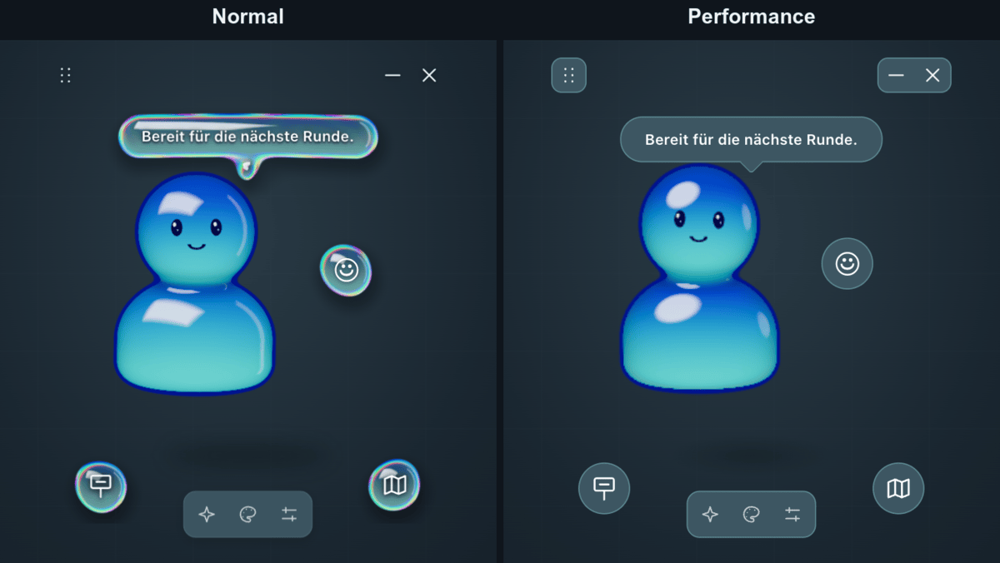
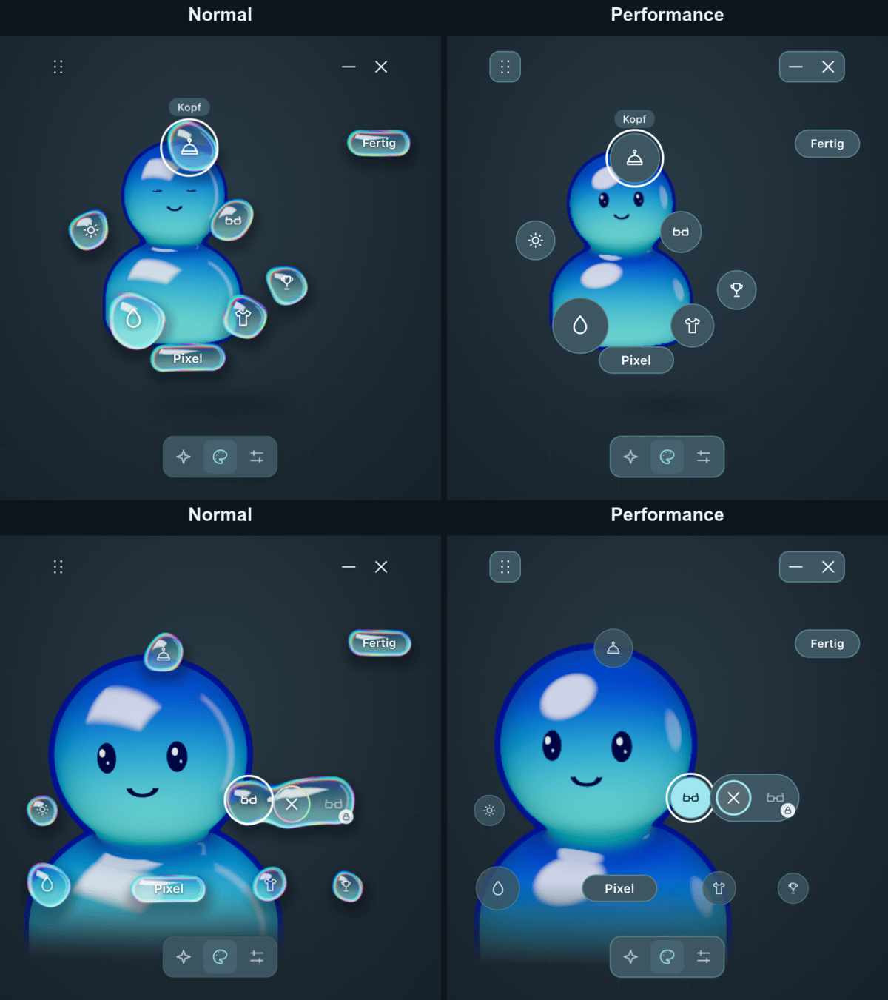
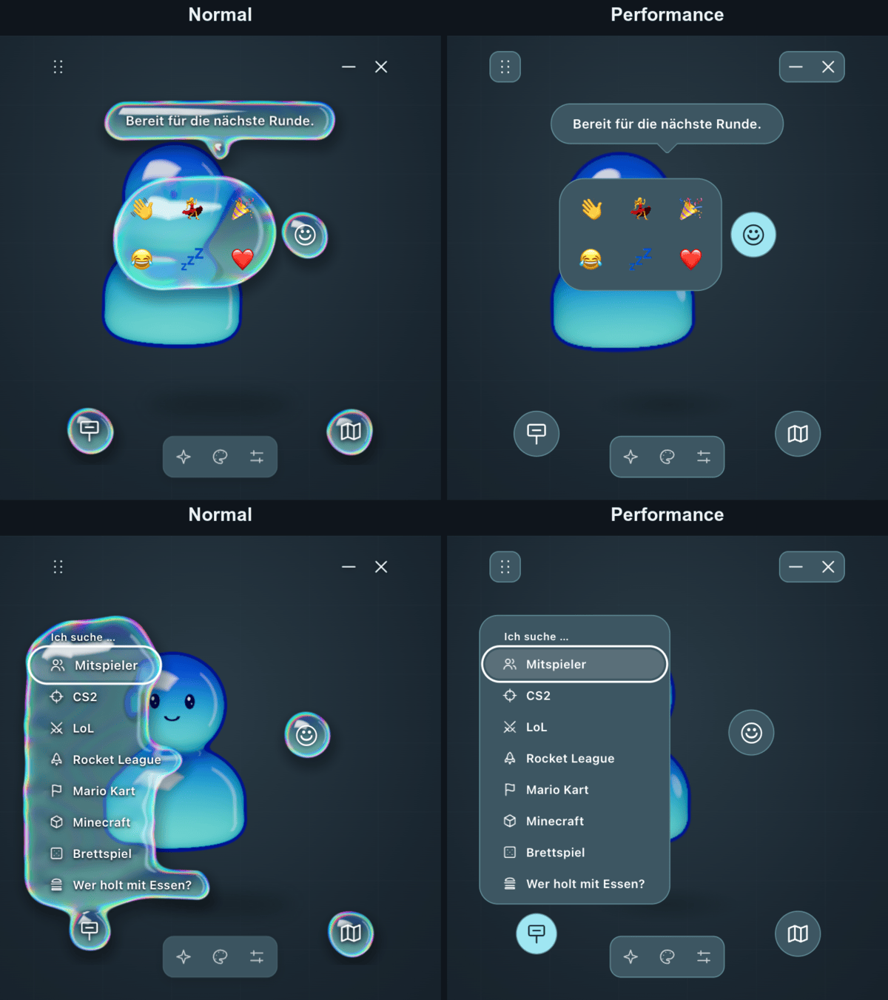
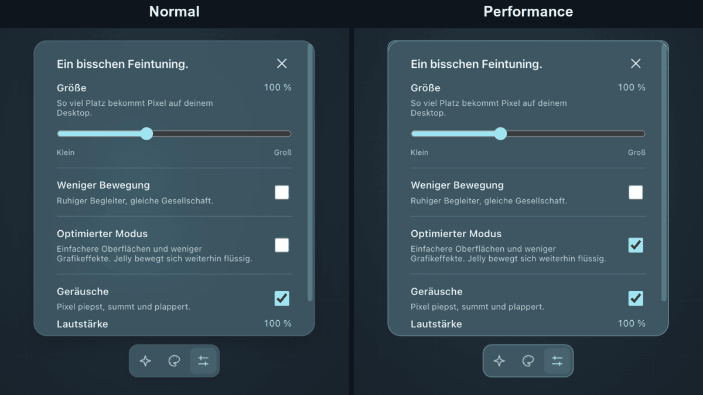
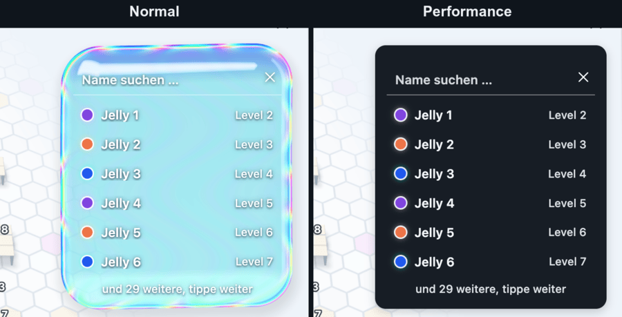

# Optimierter Modus

„Optimierter Modus“ in den Einstellungen senkt die Grafiklast für ältere PCs. Die Einstellung liegt lokal
in `jelly.json` (`optimizedRendering`), ist standardmäßig aus und wirkt ohne Neustart.

## Was sich ändert

| Hebel                  | Normal                 | Optimiert                                     |
| ---------------------- | ---------------------- | --------------------------------------------- |
| Bedienelemente am Pet  | Glas-Shader            | feste Flächen aus `src/optimized.css`         |
| Pixeldichte der Canvas | 1 bis 1,5              | 1                                             |
| Körper-Shader          | Weg durchs Innere      | Dicke aus dem Blickwinkel, feste Glanzlichter |
| CSS-Effekte            | Blur, Filter, Schweben | keine                                         |
| Knöpfe der Karte       | Glas-Shader            | feste Knöpfe, Grafikspeicher des Glases frei  |

Gleich bleiben Form, Mimik, Cosmetics, Animationen und die eingestellte Bildrate. Die Bühne der Karte und
die des Servers zeichnen weiter mit voller Qualität. Eine offene Karte übernimmt die Einstellung beim
nächsten Lesen, spätestens wenn sie wieder den Fokus bekommt.

**Downgrade:** Ältere Versionen der App lehnen das neue Feld wegen `deny_unknown_fields` ab. Dann das Feld
von Hand aus `jelly.json` entfernen, das Secret bleibt erhalten.

## Vergleich











## Messungen

Stand 5. November 2026, GPU-Zeit pro Bild im Median. Bei 30 FPS stehen für ein Bild 33,3 ms zur Verfügung.

**Ein echter älterer Laptop wurde noch nicht gemessen.** Die beiden Potato-Stufen sind Nachbildungen auf
einem Apple M1 Pro: Software-Rendering mit SwiftShader ohne GPU, in Stufe 2 zusätzlich per
`taskpolicy -b` auf die zwei Effizienzkerne begrenzt. Sie zeigen die Spanne von „schwach“ bis „Worst Case“,
sie sagen nicht voraus, was eine bestimmte integrierte GPU leistet.

| Gerät                                      | Szene     | Normal    | Optimiert | Gespart | FPS normal | FPS optimiert |
| ------------------------------------------ | --------- | --------- | --------- | ------- | ---------- | ------------- |
| M1 Pro, Metal, Retina                      | Begleiter | 2,61 ms   | 0,48 ms   | 82 %    | 30,3       | 30,3          |
| M1 Pro, Metal, Retina                      | Studio    | 2,97 ms   | 0,48 ms   | 84 %    | 30,3       | 30,3          |
| Potato-Stufe 1: ohne GPU, alle Kerne       | Begleiter | 33,86 ms  | 5,33 ms   | 84 %    | 26,0       | 30,3          |
| Potato-Stufe 1: ohne GPU, alle Kerne       | Studio    | 34,26 ms  | 5,01 ms   | 85 %    | 22,1       | 30,3          |
| Potato-Stufe 2: ohne GPU, 2 Effizienzkerne | Begleiter | 520,87 ms | 45,62 ms  | 91 %    | 1,7        | 8,9           |
| Potato-Stufe 2: ohne GPU, 2 Effizienzkerne | Studio    | 415,86 ms | 45,44 ms  | 89 %    | 2,1        | 7,8           |

Stufe 2 erreicht auch optimiert keine 30 FPS, läuft aber vier- bis fünfmal so schnell.

Beitrag der einzelnen Hebel im Begleiter, jede Zeile kommt zur vorigen dazu. Die Pixeldichte wirkt auf den
Potato-Stufen nicht, ihre Anzeige hat ohnehin Pixeldichte 1:

| Variante                 | M1 Pro  | Stufe 1  | Stufe 2   |
| ------------------------ | ------- | -------- | --------- |
| Ausgangszustand          | 2,61 ms | 33,86 ms | 520,87 ms |
| Feste Flächen, kein Glas | 0,92 ms | 6,31 ms  | 56,54 ms  |
| Pixeldichte 1            | 0,59 ms | –        | –         |
| Günstiger Körper-Shader  | 0,48 ms | 5,33 ms  | 45,62 ms  |

Der Glas-Shader ist mit Abstand der größte Einzelposten.

Weitere Szenen auf dem M1 Pro:

| Szene      | Normal  | Optimiert | Gespart |
| ---------- | ------- | --------- | ------- |
| Nahansicht | 4,17 ms | 0,82 ms   | 80 %    |
| Schilder   | 3,68 ms | 0,48 ms   | 87 %    |
| Emote      | 2,44 ms | 0,53 ms   | 78 %    |
| Duett      | 2,32 ms | 0,61 ms   | 74 %    |

**64 statt 96 Raymarching-Schritte:** verworfen. Begleiter und Studio sparten auf dem M1 Pro 6 und 10 %, auf
Stufe 1 einmal nichts (5,33 auf 5,50 ms) und einmal 2 %. Das verlangte Minimum von 10 % zusätzlicher
Ersparnis wird nicht verlässlich erreicht, es bleibt bei 96 Schritten.

### Grenzen der Messung

- Je 3 × 20 s, die weiteren Szenen 3 × 10 s, statt der vorgesehenen 3 × 60 s. Die Prüfseite läuft ohne
  Parameter mit 3 × 60 s.
- Gemessen im Browser in der Vorschau. Die Zeit erfasst nur WebGL. CSS, Fensterkomposition und die Last der
  echten Tauri-App sind nicht dabei.
- Das Ziel „mindestens halbierte GPU-Zeit und 29 FPS auf einem älteren Windows-PC mit integrierter GPU“ ist
  damit noch nicht belegt.

## Selbst messen

```sh
pnpm run webpreview:dev
```

Dann `http://127.0.0.1:1420/scripts/render-check.html` öffnen, der Tab muss sichtbar bleiben. Parameter:
`seconds`, `runs`, `warmup`, `size`, `scenes` und `variants` als kommagetrennte Listen. Mit `measure=0` laufen
nur die Prüfungen: Beide Körper-Shader kompilieren, Pause beim Verbergen, Umschalten ohne wachsende
Ressourcen. Die GPU-Zeit stammt aus `EXT_disjoint_timer_query_webgl2`, ohne die Erweiterung bleibt sie leer.

Die Potato-Stufen entstehen mit Chrome und diesen Schaltern:

```sh
--use-angle=swiftshader --enable-unsafe-swiftshader --ignore-gpu-blocklist   # Stufe 1
taskpolicy -b <chrome> …                                                     # Stufe 2, macOS
```
