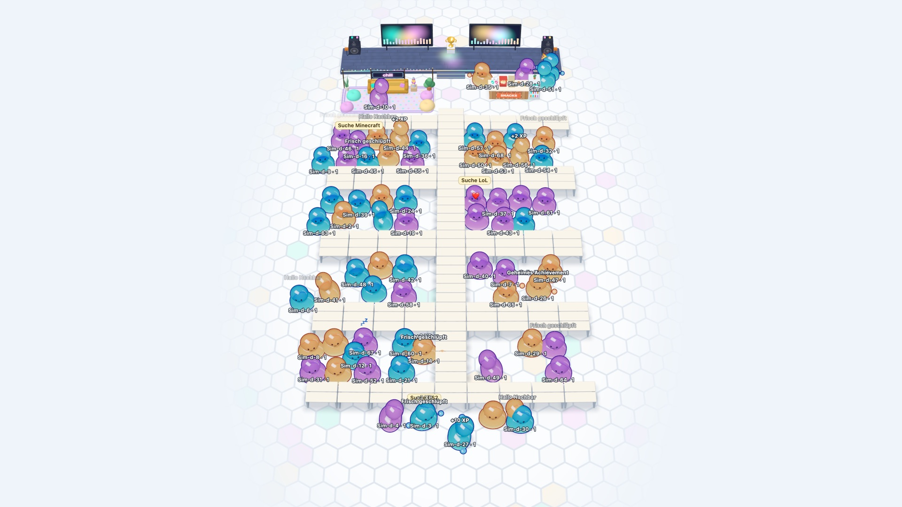

# Jelly-Server

Der Server entscheidet während einer LAN über XP und Freischaltungen. App und Bühne zeigen nur an.
Er ist in Go geschrieben und speichert in einer SQLite-Datei. Die Schnittstelle steht als Überblick
mit Changelog in [docs/api.md](docs/api.md) und als genauer Vertrag in
[docs/openapi.json](docs/openapi.json).

Gebaut sind Konten, Stupser, Berichte, Event-Codes, Cosmetics, Achievements, Emotes, Partner-Emotes,
Schilder, die Raumkarte, Moderation, der Simulator und die 3D-Bühne. Die Admin-Seite unter `/admin/` wächst noch: LANs, LAN-Code und Regeln gehen schon, der Rest läuft bis dahin über die Admin-API.

## Lokal starten

Benötigt Go 1.27, für die Bühne zusätzlich Node und `pnpm install` im Root. Eine LAN muss laufen, sonst lehnt der Server Registrierung und Stupser ab.

```sh
JELLY_JOIN_CODE=geheim go run ./cmd/jelly-server create-lan \
  -slug test -name "Test-LAN" \
  -from 2026-01-01T00:00:00+01:00 -to 2027-01-01T00:00:00+01:00
JELLY_STAGE_KEY=buehne JELLY_ADMIN_SECRET=admin go run ./cmd/jelly-server

curl -X POST localhost:8080/v1/auth/redeem -H 'Content-Type: application/json' \
  -d '{"code":"geheim","name":"Glibber","color":"mint"}'
```

## Bühne ansehen

`scripts/demo-docker.sh start` startet einen Demo-Server aus dem echten Image mit 70 simulierten
Jellies auf `127.0.0.1:18092` und nennt die Links zu Bühne und Admin-Seite. Die Daten liegen in einem
Docker-Volume und überstehen `stop` und `start`, jeder Start bringt 70 neue Jellies dazu. `reset`
fängt neu an. `scripts/demo.sh` (`pnpm demo`) macht dasselbe direkt mit Go, mit den Daten im
ignorierten Ordner `.demo/`. Dazu spielen 10 Bots des
Servers selbst und bauen auch Stapel, und jedes sechste Jelly hat keinen festen Platz und läuft als
Besucher durch die Besucher-Zone ganz vorn. Der Raum folgt dem Hallenplan der LAN: hinten die Bühne
(`stage`) mit zwei Beamern für Turniere und Public Gaming, davor links die Chillout-Lounge
(`lounge`) und rechts die Theke der Snackbar mit einer Anstellzone (`queue`). Dann in der Mitte eine Reihe Tische mit Server und
Bodentank, links und rechts Tischreihen mit Gängen dazwischen. Meist
stehen drei Reihen zusammen: Spieltische, eine Tischreihe für Switches und Kabel, wieder Spieltische.
Jeder Spieltisch ist ein Platz, die Spieler stehen im Gang davor, und die Plätze nebeneinander in
einer Reihe sind eine Gruppe (`seats`). Tische, die Theke der Snackbar und auf der Bühne Beamer, Boxen
und Pokal sind Zonen mit `blocks`, um die die Jellies herumlaufen. Jellies ohne Platz chillen in der
Lounge, auf die Bühne stellt sie ein Admin, etwa für ein Turnier. Wer Essen oder Trinken meldet, stellt
sich kurz in der Anstellzone an. Der Aufbau steht in `scripts/demo-room.sh`. Die Bühne zeichnet noch nach
der alten Zuweisung und muss `prop` erst übernehmen, Tische und Theke fehlen bis dahin im Bild.



```sh
scripts/demo-docker.sh start       # aus dem echten Image, Ende mit stop, Neuanfang mit reset
scripts/demo-docker.sh start 0     # nur die 10 Bots des Servers, ohne Simulator
pnpm demo                          # direkt mit Go, Daten in .demo/
scripts/record-demo.sh videos 20   # nimmt 20 Sekunden als MP4 und GIF auf, braucht Firefox und ffmpeg
```

Auf dem echten Server steht die Bühne unter `/stage/?key=<JELLY_STAGE_KEY>`. Sie zeigt einen hellen
Platz in 3D mit denselben Jellies wie die App (`packages/jelly-scene`). Wohin ein Jelly will, ist eine
reine Funktion aus Spieler-ID und Serverzeit, daher wollen auf allen Bildschirmen alle Jellies an
dieselbe Stelle und der Server speichert keine Positionen. Danach schiebt jeder Bildschirm die Ziele
auseinander, die zu dicht liegen, in derselben Reihenfolge, also mit demselben Ergebnis. Den Weg um
die Hindernisse sucht jeder Bildschirm selbst, während ein Jelly läuft, können Bildschirme also kurz
voneinander abweichen. Den Gang zur Snackbar sieht nur ein Bildschirm, der beim Ereignis offen war.

Im Gedränge behalten die vorderen Jellies Namen und Schild. Ein Text, der einen näheren überdecken
würde, fällt weg, bis wieder Platz ist.

Bühne, Lounge und Snackbar sind eingerichtet, und manches bewegt sich: Spots wandern über die
Bühnenbretter, die Boxen pumpen im Takt, in der Lounge blubbert eine Lavalampe unter Lichterketten,
an der Theke dreht sich Slush und Lauflichter umrahmen das Schild. Die Bauteile stehen in
`packages/jelly-stage/src/stageSet.ts`, `lounge.ts` (mit `couch.ts` und `plants.ts`) und `snackBar.ts` (mit
`snacks.ts`). Gemeinsame Materialien und Helfer liegen in `props.ts`, Lichterketten in `bulbs.ts`
und Leuchtschilder in `signs.ts`.

Gleiche Teile teilen sich Geometrie und Material, damit die Bühne wenige Draw-Calls braucht: Alle
Tischplatten sind ein Mesh, alle Tischbeine eines, die Schatten der Jellies ein `InstancedMesh`, und
ein Auge des Jellys ist ein Mesh mit Vertexfarben statt drei.

Die Kamera schaut durch ein leichtes Fischauge, so wirkt der Raum wie ein Stück einer kleinen Kugel.
`?lens=0` schaltet es ab, `?lens=1` biegt stark (Standard 0,55). Namen und Schilder folgen dem Bild.

Die Bühne zeichnet je Seite doppelt so viele Bildpunkte wie der Bildschirm hat, höchstens etwa 4K,
und der Browser rechnet das Bild herunter. Das glättet alle Kanten, auch die der Jellies, die die
Kantenglättung der Grafikkarte nicht erfasst. Die Jellies werden geraymarcht und kosten pro
Bildpunkt viel Grafikleistung. `?scale=0.5` halbiert die Auflösung des 3D-Bilds für schwache
Rechner, dann hat es so viele Bildpunkte wie der Bildschirm. `?scale=2` verdoppelt sie (Bereich 0,25
bis 2).
Messungen stehen in [benchmarks/README.md](benchmarks/README.md), gemessen mit
`node benchmarks/stage.mjs`.

## Simulator

`jelly-server simulate` spielt viele Jellies über die öffentliche API und braucht keine Datenbank.
Damit lässt sich auch der Server auf dem VPS prüfen. Eine LAN muss laufen.

```sh
JELLY_JOIN_CODE=geheim go run ./cmd/jelly-server simulate -url http://localhost:8080
```

| Option       | Standard                | Zweck                                  |
| ------------ | ----------------------- | -------------------------------------- |
| `-url`       | `http://localhost:8080` | Adresse des Servers                    |
| `-players`   | 70                      | Anzahl der Jellies, höchstens 1000     |
| `-min-delay` | `2s`                    | Kürzeste Zeit zwischen zwei Aktionen   |
| `-max-delay` | `20s`                   | Längste Zeit zwischen zwei Aktionen    |
| `-duration`  | `0`                     | Laufzeit, `0` läuft bis zu einem Signal |
| `-run-id`    | zufällig                | Teil der Namen, gleiche ID auf derselben Datenbank kollidiert |

Am Ende stehen im Log angenommene und abgelehnte Aktionen, Fehler und Antwortzeiten. Können alle Bots
sich nicht anmelden, endet der Lauf mit dem Grund. Messungen stehen in
[benchmarks/README.md](benchmarks/README.md).

## Befehle

Über pnpm läuft der Server mit `pnpm test`, `pnpm lint`, `pnpm build` und `pnpm format` zusammen mit
dem Rest des Monorepos. Lint und Formatierung starten die feste Version von `golangci-lint` über
`go run`, ohne globale Installation. Beim ersten Aufruf lädt Go das Werkzeug in seinen Cache.
Die Version und alle Code-Regeln stehen in [AGENTS.md](AGENTS.md). Die Bühne bündelt `three`, `@jelly/scene` und `@jelly/stage` aus `node_modules`, daher
muss vor `go generate` einmal `pnpm install` im Root laufen. Gebündelt wird über `go tool esbuild`.

| Variable          | Standard   | Zweck                                       |
| ----------------- | ---------- | ------------------------------------------- |
| `JELLY_DB`        | `jelly.db` | Pfad zur Datenbank                          |
| `JELLY_ADDR`      | `:8080`    | Adresse des Servers                         |
| `JELLY_JOIN_CODE` | keiner     | Anmeldecode, nur für `create-lan` nötig     |
| `JELLY_STAGE_KEY` | keiner     | Pflicht: Schlüssel der Bühne                |
| `JELLY_ADMIN_SECRET` | keiner  | Pflicht: Geheimnis der Admin-Anmeldung      |
| `JELLY_MIN_CLIENT_VERSION` | keine | Älteste App, die noch funktioniert, Form `1.2.3` |

Im Betrieb gehört `/admin` hinter den Proxy und ist dort auf die Orga zu beschränken, etwa per Adresse oder zusätzlichem
Passwort. Alle Anmeldeversuche teilen sich einen Zähler, sonst könnte jeder im LAN die Orga mit falschen Versuchen aussperren.

## Aufbau

| Ort                | Inhalt                                                  |
| ------------------ | ------------------------------------------------------- |
| `cmd/jelly-server` | Einstieg, Serverstart, `create-lan`, `simulate`, `openapi` |
| `internal/api`     | HTTP-Wege, OpenAPI über huma, Fehlercodes               |
| `internal/store`   | SQLite, Transaktionen, goose-Migrationen in `migrations/` |
| `internal/architecture` | Tests für Regeln, die kein Linter prüft            |
| `internal/rules`   | Spielregeln als reine Funktionen, ohne IO               |
| `internal/simulator` | Simulierte Spieler, nutzt nur die öffentliche API     |
| `internal/web`     | Liefert die gebauten Seiten aus, mit Sicherheits-Headern |
| `web/stage`        | Die Seite der Bühne und ihr Weg zum Server, die Bühne selbst steht in `packages/jelly-stage` |
| `scripts`          | Wiederholbare Hilfen wie die Demo                       |
| `benchmarks`       | Lasttest und Baselines                                  |
| `testdata/contract`| Regelfälle als JSON, Teil des API-Vertrags              |

## Betrieb

Das Image entsteht aus dem `Dockerfile` und wird vom Root des Repos gebaut, weil es die Pakete
`packages/jelly-scene` und `packages/jelly-stage` braucht: `docker build -f apps/server/Dockerfile -t jelly-server .`. Was in
den Build gelangt, regelt `Dockerfile.dockerignore`. Der Server speichert unter `/app/data`, das als
Volume bestehen bleiben muss. SIGINT und SIGTERM beenden den Server geordnet, offene Anfragen haben dafür bis zu 8
Sekunden und damit weniger als die 10 Sekunden von `docker stop`. Die Datenbank darf nicht im
laufenden Betrieb einfach kopiert werden. Backups entstehen mit `sqlite3 jelly.db "VACUUM INTO 'backup.db'"` und gehören auf ein anderes System.
