# Architektur des Servers

Überblick für Entscheidungen, Stand `origin/main` (API 1.35.0, `internal/api/openapi.go:APIVersion`). Alles
stammt aus dem Code, die Quelldateien stehen unter jedem Diagramm. Pfade sind relativ zu `apps/server`.
Zur Schnittstelle selbst siehe [api.md](api.md), zu Regeln und Betrieb die [README](../README.md).

## 1. Module und Abhängigkeiten

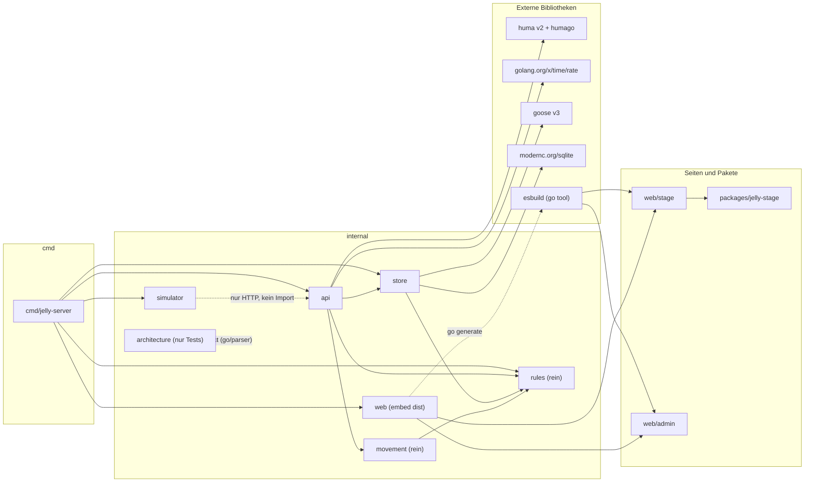

Quellen: Imports in `cmd/jelly-server/*.go`, `internal/*/*.go` (ohne Tests), `go.mod`, `internal/web/web.go`
(`go:generate`), `web/stage/main.ts` und `web/stage/connection.ts` (Import `@jelly/stage`).

- Die Richtung ist sauber: `rules` importiert nichts aus dem Projekt, `movement` und `store` nur `rules`, `api` die drei.
- `simulator` importiert kein internes Paket und spielt nur über HTTP (`cmd/jelly-server/simulate.go`).
- Nur `web/stage` nutzt `@jelly/stage`, `web/admin` bringt eigene Seiten ohne das Paket mit.
- `kin-openapi` kommt nur in `internal/api/openapi_test.go` vor, nicht im Produktivcode.
- `internal/architecture/architecture_test.go` erzwingt einen `main`, benannte SQL-Konstanten (`...SQL`) und einen
  Kommentar `Concurrency plan:` an jeder Goroutine.

## 2. Laufzeit und Prozess

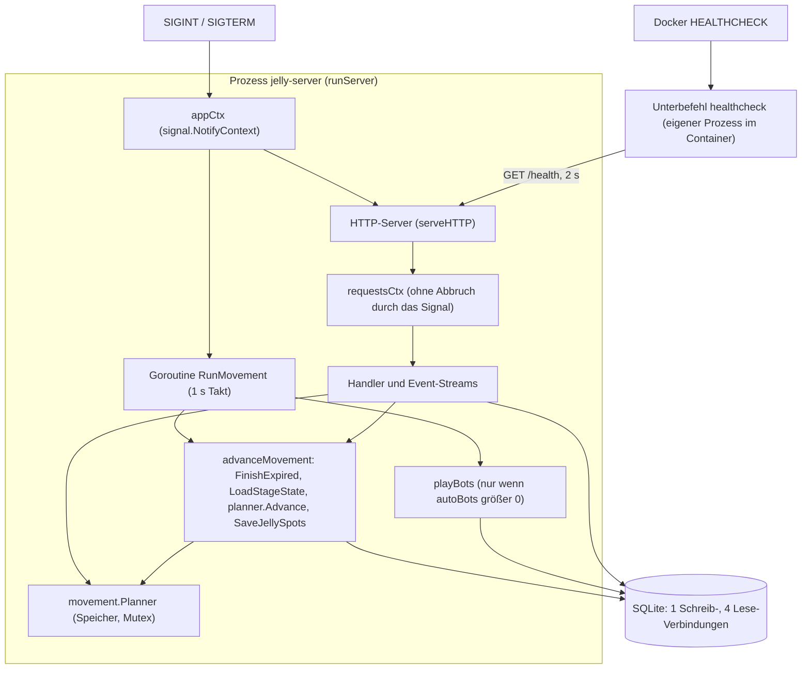

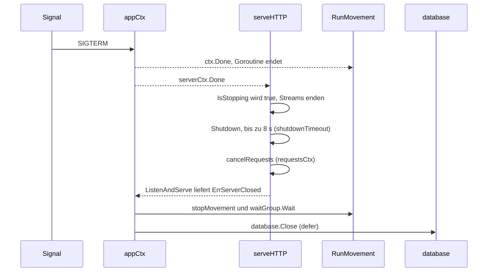

Quellen: `cmd/jelly-server/main.go:runProgram`, `server.go:runServer, serveHTTP, shutdownServer`, `healthcheck.go`,
`internal/api/movement_stream.go:RunMovement, advanceMovement`, `internal/api/bot_handlers.go:playBots`,
`internal/store/store.go:Open`, `Dockerfile` (HEALTHCHECK).

- Eine langlebige Goroutine (`RunMovement`), dazu eine kurze beim Shutdown (`server.go`, `waitGroup.Go` in `serveHTTP`).
- Anfragen laufen auf `requestsCtx`, das erst nach `Shutdown` abgebrochen wird: ein Signal bricht keine laufende
  Transaktion ab (`server.go:serveHTTP`, Kommentar "Problem/Example/Fix").
- Timeouts des HTTP-Servers: Header 5 s, Lesen 15 s, Schreiben 30 s, Idle 2 min (`server.go`). Streams verlängern ihre
  Schreibfrist bei jeder Nachricht (`stage_handlers.go:extendWriteDeadline`, 10 s).
- Shutdown: 8 s, unter den 10 s von `docker stop` (`server.go:shutdownTimeout`). Die Streams prüfen `IsStopping` in
  jedem Takt (`stage_handlers.go:sendStreamTicks`).
- Der Planner hält Positionen und Bewegungs-Journal nur im Speicher. Aufgefrischt wird er pro Sekunde und bei jedem
  Lesen der Bühne, `ClaimAdvance` lässt nur den Ersten pro Sekunde durch (`internal/movement/planner.go:ClaimAdvance`).
  Positionen sichert `SaveJellySpots` (Migration `0012_jelly_spots.sql`). `autoBots` steht nur im Speicher (`api.go`).

### Event-Streams (SSE) und Limits

| Grenze | Wert | Stelle |
| --- | --- | --- |
| Abfrage der Datenbank je Stream | alle 500 ms | `stage_handlers.go:streamPollInterval` |
| Keep-Alive-Kommentar | alle 30 Takte, also 15 s | `streamKeepAliveTick` |
| Schreibfrist je Nachricht | 10 s | `streamWriteTimeout` |
| Offene Streams gesamt / je Spieler | 200 / 3, je LAN in den Regeln | `rules.go:defaultMaxStreams`, `defaultMaxPlayerStreams`, `stream_slots.go:claimSlot` |
| Nachholen für Spieler | höchstens 1000 Ereignisse, sonst `reset` | `maxPlayerReplayEvents`, `findStreamStart` |
| Ereignisse je Abfrage | 200 | `store/events.go:maxEventsPerQueryRows` |
| Bühne (Schlüssel) | zählt nicht in die Limits | `stream_slots.go:24` |

## 3. Anfrageweg

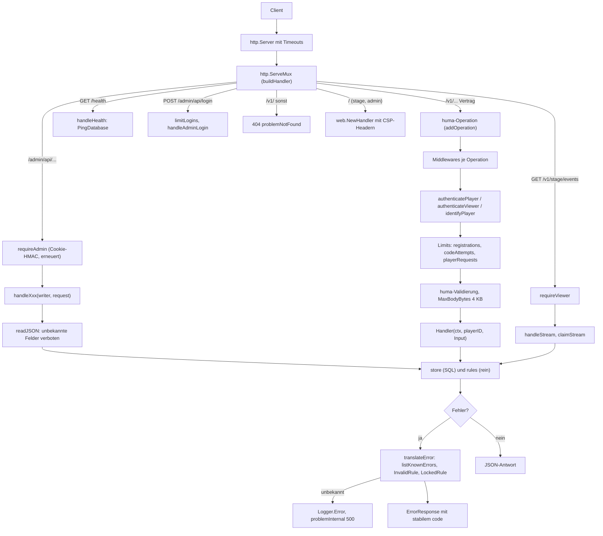

Quellen: `internal/api/api.go:buildHandler`, `openapi.go` (`addOperation`, `addPlayerOperation`, `authenticate*`,
`limit*`, `translateLibraryError`), `auth.go`, `session.go`, `responses.go` (`translateError`, `listKnownErrors`,
`readJSON`, `writeOutcome`), `admin_handlers.go:addAdminRoutes`, `stage_handlers.go`, `internal/web/web.go`.

- Es gibt keine allgemeine Middleware (`logRequests` existiert nicht, auch kein `recover`). Geloggt wird nur bei
  unbekannten Fehlern (`translateError`) und Warnungen. Panics fängt nur `net/http` je Verbindung.
- Drei Auth-Arten: Bearer-Token (`findPlayer`), Bühnenschlüssel `?key=` (`matchSecret`, konstante Zeit), Admin-Cookie
  `jelly_admin` (HMAC über Ablaufzeit, 30 min Leerlauf, `session.go`).
- `authenticatePlayer` prüft zuerst das Token und zählt danach pro Spieler (300/min, Burst 60), damit Fremde keine
  Limits verbrauchen (`openapi.go:131`, `api.go` Konstanten).
- Fehler sind Werte: Handler geben `store.Err...` zurück, `translateError` bildet sie auf `problem` (Status, `code`,
  deutsche `message`) ab. Fehler ohne Eintrag werden geloggt und als 500 beantwortet.
- Die Admin-Wege liegen bewusst außerhalb des Vertrags (`docs/api.md`, Zeile 23) und nutzen eigene Handler statt huma.

## 4. Datenmodell

Endstand nach 24 Migrationen (`internal/store/migrations/0001` bis `0024`), SQLite STRICT, Zeiten in Unix-ms.

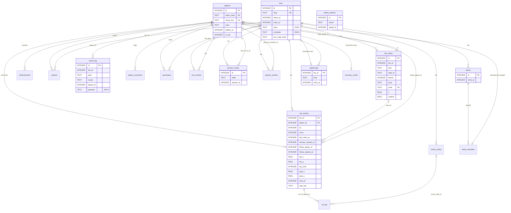

Quellen: `internal/store/migrations/*.sql`, geladen von `internal/store/migrations.go` (`go:embed`, goose-Provider).
`admin_actions` hat keinen Fremdschlüssel (`target_id` ist nur eine Zahl), `event_log.lan_id` ebenfalls nicht.

- Eine Schreib-Verbindung (`_txlock=immediate`, WAL) und vier Lese-Verbindungen mit `query_only`
  (`store.go:Open`, `runInTransaction` mit 5 s). Zustand und Verlauf schreibt jede Aktion in einer Transaktion.
- `lan_entries` ist die breite Mitte: XP, Münzen, Anwesenheit, Folgen, Ausflug, letzte Position, Zone und Schild.
- Regeln (`lans.rules`) und Zeitplan (`lans.schedule`) liegen als JSON; Migration `0021` rechnet Regeln per SQL-JSON um.
- Löschen läuft über `ON DELETE CASCADE` und `SET NULL`; Ereignis-Nutzdaten enthalten keine Namen
  (Kommentar in `0002_game_features.sql`).
- `0022` und `0023` bauen `players` neu auf (CHECK auf `color` lässt sich in SQLite nicht ändern), mit
  `+goose NO TRANSACTION` und abgeschalteten Fremdschlüsseln, weil 13 Tabellen darauf zeigen.

## 5. Zustände

### LAN

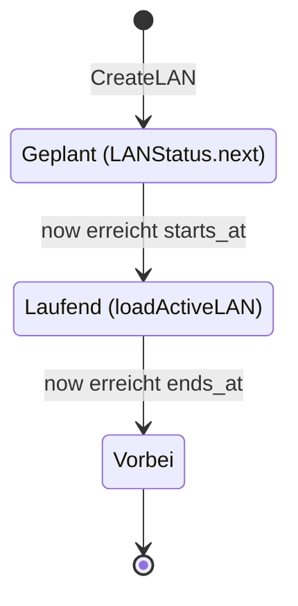

Quellen: `store/lans.go:loadActiveLAN, LoadLANStatus, CreateLAN`, `store/lan_changes.go:requireFreePeriod`.
Es gibt keinen gespeicherten Zustand, nur `starts_at <= now < ends_at`. Zeiträume dürfen sich nicht überlappen, also
läuft höchstens ein LAN. Ohne laufendes LAN liefern Aktionen `ErrNoActiveLAN`, `LoadCurrentRules` die Standardregeln und
`FinishExpired` tut nichts.

### Spieler und Anwesenheit

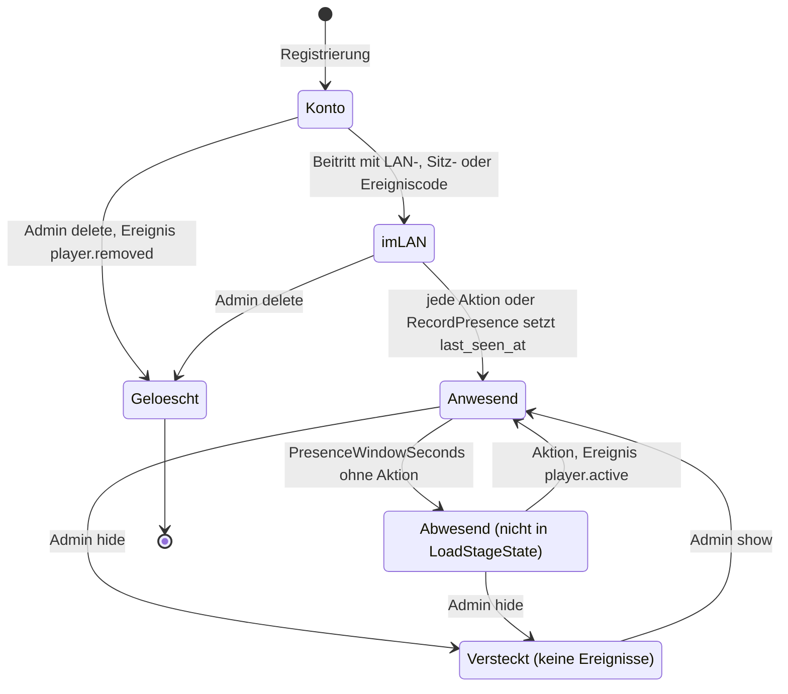

Quellen: `store/actions.go:beginPlayerAction, RecordPresence`, `rules/rules.go:IsPresent` (Standard 5400 s),
`store/stage.go:LoadStageState` (filtert Abwesende), `store/admin.go:HidePlayer, ShowPlayer, DeletePlayer`,
`store/actions.go:appendVisibleEvent` (versteckte Jellies erzeugen keine Ereignisse). Es gibt kein Ereignis für "wird abwesend",
die Bühne leitet es aus `last_seen_at` ab. Wiederherstellung per Code: `store/recovery.go`.

### Bewegung: Ausflug, Folgen, Stapel, Versammlung

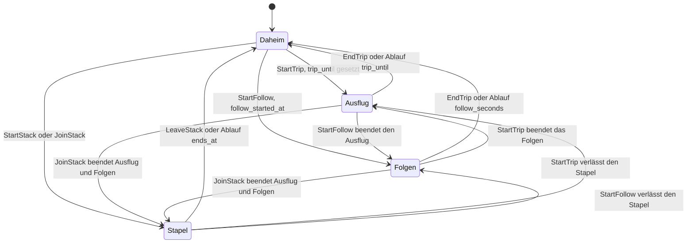

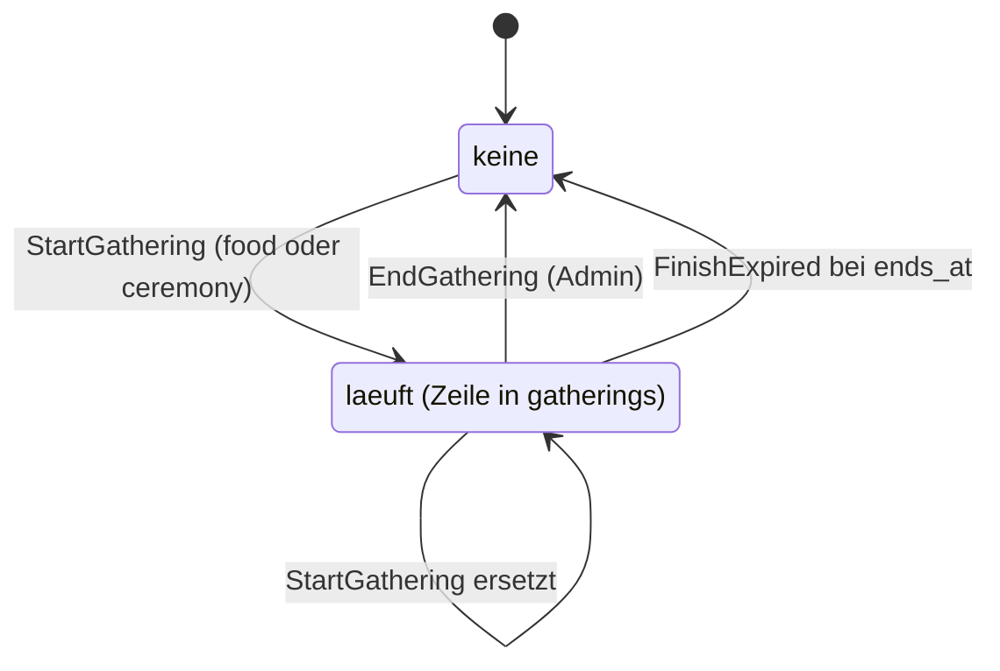

Quellen: `store/trips.go:StartTrip, StartFollow, writeFollow`, `store/stacks.go:StartStack, addStackMember,
removeStackMember`, `store/endings.go:FinishExpired, loadExpired, finishAll, endTrip, endFollow, finishStack, finishGathering`,
`store/gatherings.go`, `rules` (`CalculateTripEnd`, `CalculateFollowCutoff`, `CalculateStackEnd`).

- `FinishExpired` läuft im Takt von `advanceMovement`, schreibt nur bei Ablauf und meldet es als Ereignis
  (`trip.changed`, `follow.changed`, `stack.changed`, `gathering.changed`). Ein Neustart verliert nichts, Abgelaufenes
  bleibt gespeichert und wird beim nächsten Takt beendet (Kommentar in `endings.go`).
- Eine Versammlung überlagert die Bewegung, ohne sie zu beenden ("What they were doing keeps running", `gatherings.go`).
- Das Hervorheben (`highlight`) speichert keinen Zustand, nur `ends_at` im Ereignis (`stacks.go:ApplyHighlight`).

### Einladung zum Partner-Emote

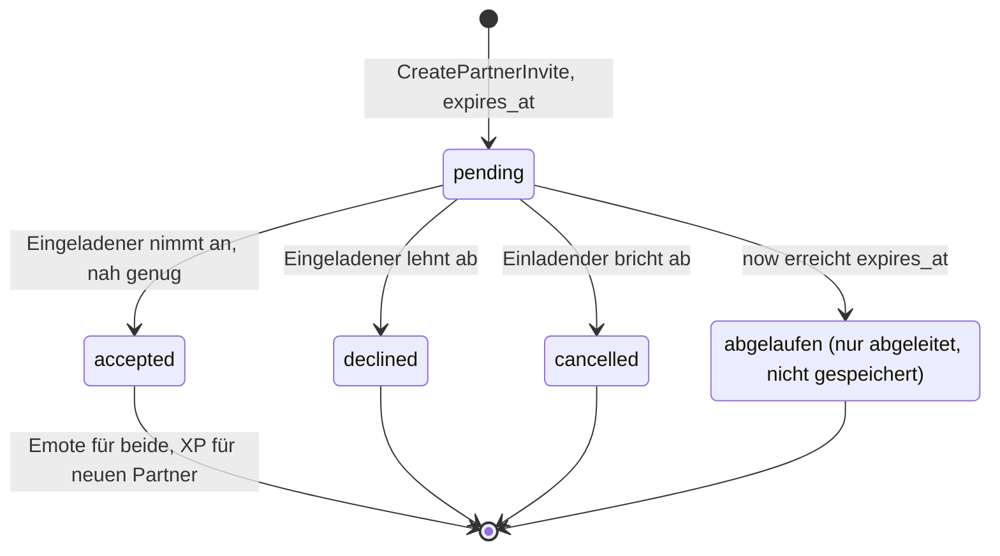

Quellen: `store/partners.go:insertPartnerInvite, loadAnswerableInvite, AnswerPartnerInvite, ListOpenPartnerInvites`.
`abgelaufen` wird nicht geschrieben: `loadAnswerableInvite` lehnt mit `ErrInviteClosed` ab, die Liste filtert
`expires_at > now`. Standarddauer 120 s (`rules.go:defaultPartnerInviteSeconds`). Pro Paar nur eine offene Einladung
(`ErrInviteOpen`). Zeilen werden nie gelöscht.

### Event-Stream-Verbindung

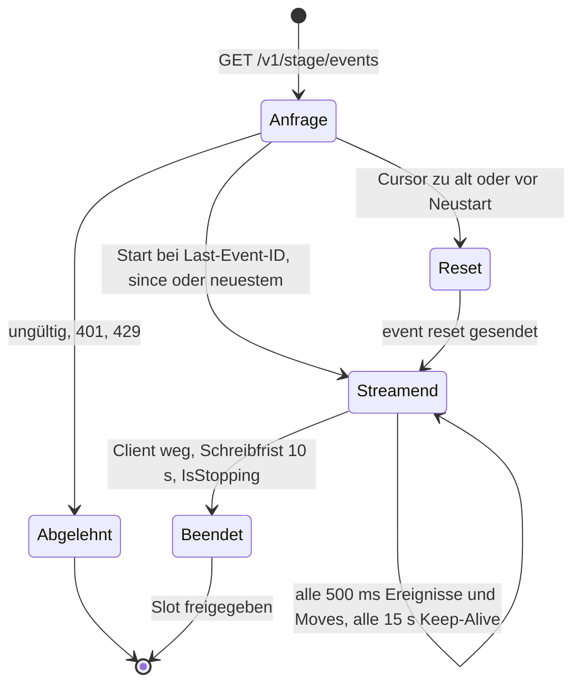

Quellen: `api/stage_handlers.go:handleStream, claimStream, findStreamStart, sendStreamTicks`,
`api/stream_slots.go`, `api/movement_stream.go:writeStreamUpdates`.

## 6. Ereignisse

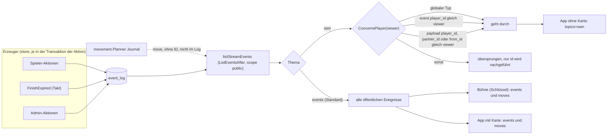

Globale Typen für alle (`store/events.go:listGlobalEventTypes`): `rules.changed`, `stage.changed`,
`gathering.changed`, `schedule.changed`.

| Typ | Erzeuger (Datei:Funktion) |
| --- | --- |
| `player.active` | `actions.go:beginPlayerAction` (Rückkehr), `players.go:insertLANEntry` (Beitritt), `admin.go` (show) |
| `player.updated` | `players.go:recordProfileEdit`, `cosmetics.go:removeLockedCosmetics`, `admin.go` (Name zurücksetzen) |
| `player.hidden`, `player.removed` | `admin.go` (HidePlayer, DeletePlayer) |
| `xp.gained`, `level.up` | `actions.go:announceXP` |
| `coins.gained` | `coins.go:grantCoins` |
| `cosmetic.purchased` | `purchases.go` |
| `achievement.earned` | `achievements.go:insertAchievement` |
| `award.given` | `admin.go:insertAward` |
| `emote`, `sign.changed` | `social.go` |
| `follow.changed`, `trip.changed` | `trips.go`, `endings.go:endFollow, endTrip` |
| `stack.changed` | `stacks.go`, `endings.go:finishStack` |
| `highlight` | `stacks.go:ApplyHighlight` |
| `partner_emote.updated`, `partner.emote` | `partners.go:insertPartnerInvite, AnswerPartnerInvite, recordPartnerEmote` |
| `stage.changed` | `areas.go:appendStageChanged` |
| `gathering.changed` | `gatherings.go:appendGatheringChanged` (auch `finishGathering`) |
| `rules.changed` | `lans.go:UpdateLANRules` (Regeländerung) |
| `schedule.changed` | `schedule.go:storeSchedule` |

Quellen: `internal/store/events.go` (Konstanten, `ConcernsPlayer`), `actions.go:appendVisibleEvent`,
`api/movement_stream.go:listStreamEvents, parseStreamTopics`.

- Alle Ereignisse haben `scope = public`; `scope = 'player'` ist in der Tabelle erlaubt, wird im Code nicht geschrieben
  (`events.go:scopePublic`, Kommentar "allows private events later").
- Nutzdaten tragen IDs und Schlüssel, keine Namen. Versteckte Jellies erzeugen über `appendVisibleEvent` nichts.
- Das Thema `own` ist für Bühnen mit Schlüssel verboten (`stage_handlers.go:128`, `ErrInvalidInput`).
- Moves (`event: move`) stammen aus dem Planner und haben keine ID, neue Verbindungen bekommen zuerst die aktuellen Moves.

## 7. Betrieb

```mermaid
flowchart LR
  tag["git tag server-vX.Y.Z"] --> wf["Forgejo Workflow server-image.yml"]
  wf --> chk["Tag muss auf main liegen (merge-base)"]
  chk --> tools["docker CLI und buildx nachladen"]
  tools --> login["Login mit REGISTRY_TOKEN"]
  login --> bx["docker buildx build, linux/amd64, push"]
  bx --> reg[("forge.stash.deadpostbox.net/tomek/jelly-server: VERSION und latest")]
  reg --> run["Container (Host, Stack nicht im Repo)"]
  run --> traefik["Traefik: SSE ungepuffert, /admin beschränken"]
```

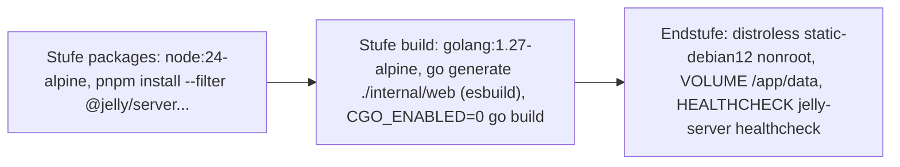

Quellen: `Dockerfile`, `.forgejo/workflows/server-image.yml` (Repo-Root), `README.md` Abschnitt Betrieb und Umgebung.

| Variable | Standard | Wirkung (Stelle) |
| --- | --- | --- |
| `JELLY_DB` | `jelly.db` (im Image `/app/data/jelly.db`) | Datenbankpfad (`main.go:openDatabase`) |
| `JELLY_ADDR` | `:8080` | Adresse, auch für `healthcheck` (`server.go`, `healthcheck.go`) |
| `JELLY_STAGE_KEY` | Pflicht | Bühnenschlüssel (`server.go:runServer`) |
| `JELLY_ADMIN_SECRET` | Pflicht | Admin-Anmeldung, Cookie-Signatur |
| `JELLY_MIN_CLIENT_VERSION` | leer | älteste App, geprüft mit `rules.ValidateClientVersion` |
| `JELLY_HTTP_DEMO` | `0` | Admin-Cookie ohne `Secure`, nur Demo |
| `JELLY_JOIN_CODE` | leer | nur für `create-lan` und `simulate` |

- Der Server startet ohne `JELLY_STAGE_KEY` oder `JELLY_ADMIN_SECRET` nicht (`errMissingSecret`).
- Backups: `VACUUM INTO` auf ein anderes System, die Datei nicht im Betrieb kopieren (README).
- Unterbefehle: `create-lan`, `simulate`, `openapi`, `healthcheck` (`main.go:runProgram`).
- Das Image hat keine Shell, der Healthcheck ist daher ein Unterbefehl des Servers.

## Auffälligkeiten

Nur Befunde mit Beleg, ohne Korrekturen.

1. **Keine automatischen Server-Tests oder Lint im CI.** `.github/workflows/client.yml` schließt `apps/server/**` aus
   (Zeile 7), `.forgejo/workflows/server-image.yml` baut nur das Image. Ein Treffer für `go test` oder `golangci` in
   `.github` und `.forgejo` fehlt. Ein Tag baut also ein Image ohne vorherigen Testlauf.
2. **Zwei parallele Auth-Wege mit unterschiedlichem Umfang.** `auth.go:requireViewer/requirePlayer` (nur Stream) und
   `openapi.go:authenticateViewer/authenticatePlayer` (Vertrag). Der Vertragsweg prüft Rate-Limit und
   `RequireCurrentEntry` in der Middleware, der Streamweg erst in `stage_handlers.go:claimStream` (Zeile 188).
   Doppelte Logik, leicht auseinanderlaufend.
3. **Bühnen-Streams sind unbegrenzt.** `stream_slots.go:24` und `:40` lassen `noViewerPlayer` durch. Jeder mit dem
   Bühnenschlüssel kann beliebig viele Streams öffnen, jeder fragt alle 500 ms die Datenbank (`streamPollInterval`).
   Der Schlüssel steht zudem in der URL (`?key=`, `auth.go:requireViewer`, `admin_event_handlers.go:handleStageLink`), also
   in Proxy-Logs. `web.go` setzt `Referrer-Policy: no-referrer`, das schützt nur vor Weitergabe an Seiten.
4. **Last wächst mit der Zahl der Streams.** `sendStreamTicks` ruft je Stream und Takt `writeStreamUpdates` →
   `advanceMovement` und `ListEventsAfter` (`movement_stream.go:62`, `stage_handlers.go:161`). Bei 200 erlaubten
   Streams (`rules.go:40`) sind das bis zu 400 Lesezugriffe pro Sekunde, nur das Planen selbst ist über `ClaimAdvance`
   gedeckelt. Die Entscheidung gegen einen Broadcaster steht im Kommentar `stage_handlers.go:117`.
5. **Bots teilen die Goroutine der Bewegung.** `movement_stream.go:144`: `advanceMovement` und `playBots` laufen im
   selben Takt hintereinander, eine langsame Bot-Aktion verzögert Planung und `FinishExpired`. `bot_handlers.go:114`
   (`runBotAction`) wiederholt zudem die Aufrufe der Spieler-Routen (Doppelung).
6. **Anhaltend wachsende Daten ohne Aufräumen.** Kein `DELETE FROM event_log` im Code (nur über `ON DELETE CASCADE`
   eines Spielers), `partner_invites` und `admin_actions` werden nie gelöscht. `partner_handlers.go:19`
   (`playerLimiters`) wächst mit jedem Spieler und wird nie geleert (begrenzt durch die Spielerzahl).
7. **Verantwortungen vermischt.** `movement_stream.go` (262 Zeilen) enthält Stream-Themen, den Takt `RunMovement`,
   Aufbau des Rosters (`buildRoster`, Zeile 197) und das Sichern der Positionen (`saveJellySpots`, Zeile 178).
   `playerLimiters` steht in `partner_handlers.go`, wird aber auch für Logins und Anfragen aller Spieler genutzt
   (`api.go`). `responses.go` (467 Zeilen) mischt Fehlerkatalog, Übersetzung und Schreibhelfer.
8. **Große Dateien nahe der Grenze von etwa 500 Zeilen** (ohne Tests): `simulator/bot.go` 490,
   `api/admin_handlers.go` 489 (enthält die komplette Routentabelle), `api/responses.go` 467, `store/state.go` 439,
   `api/player_handlers.go` 411, `store/lans.go` 406.
9. **`listKnownErrors()` baut bei jedem Fehler sieben Listen neu auf** und durchsucht sie linear
   (`responses.go:89, 425`). Auf dem Fehlerpfad vertretbar, aber ein Treffer pro Anfrage mit Fehler.
10. **Schema: kleine Abweichungen.** `recovery_codes` ist als einzige Tabelle nicht `STRICT`
    (`0014_recovery_codes.sql`). `event_log.scope` erlaubt `player`, der Code schreibt es nie. `lan_entries` hat 16
    Spalten für fünf Themen (Fortschritt, Anwesenheit, Folgen, Ausflug, Zone).
11. **Zustand nur im Speicher, genau eine Instanz möglich.** `Planner` (Positionen, Journal), `streamSlots`,
    `playerLimiters`, `autoBots` (`api.go`). Ein zweiter Server-Prozess würde sie nicht teilen. Dazu ist die
    SQLite-Datei an einen Prozess gebunden (eine Schreib-Verbindung).
12. **Admin-Sitzung ist zustandslos.** `session.go:handleAdminLogout` löscht nur das Cookie im eigenen Browser, eine
    Kopie bleibt bis zum Ablauf gültig (Kommentar im Code). Ein gemeinsames Geheimnis, keine Benutzerkennung
    (`0005_admin_actions.sql`: "does not say who did it").

## Zustandslücken

Jeder Übergang aus Abschnitt 5 wurde gegen den Code geprüft (nur gelesen, nichts ausgeführt, keine Tests gestartet).
Pfade relativ zu `apps/server`, `store/` ist `internal/store/`, `api/` ist `internal/api/`. Einschätzung: **sicher** =
aus Code oder Schema eindeutig ablesbar, **wahrscheinlich** = Ablauf folgt aus dem Code, nicht nachgestellt,
**vermutet** = hängt von etwas ab, das hier nicht zu sehen ist (etwa Verhalten der App).

Grundlage der meisten abgedeckten Fälle: Schreibzugriffe laufen über genau eine Verbindung mit `_txlock=immediate`
(`store/store.go:Open`, `runInTransaction`), und die Regelprüfungen stehen in derselben Transaktion. Zwei Anfragen auf
denselben Zustand laufen so nacheinander. Lücken entstehen dort, wo vor der Transaktion gelesen wird, etwas nur im
Speicher liegt oder eine Änderung kein Ereignis schreibt.

**Schwere hoch (falsche XP oder Münzen, hängender Zustand während der LAN): kein Befund.** XP und Münzen schreiben
Summe, Verlauf und Ereignis in einer Transaktion (`store/actions.go:grantXP`, `store/coins.go:grantCoins, spendCoins`).
Es gibt keinen Schreibweg außerhalb von `runInTransaction` (einziger Treffer für `writeDB.`: `store/store.go:72`).

### Schwere mittel

1. **Uhr springt zurück: Bewegung und Ende-Ereignisse stehen still** (Uhr, Bewegung; wahrscheinlich, selten).
   Szenario: Systemuhr springt um D zurück (NTP-Schritt, VM-Migration). `ClaimAdvance` prüft
   `now - lastAdvance < 1000`, das ist negativ, also gibt es D lang kein `advanceMovement`: keine Planung, kein
   `FinishExpired`, keine Ereignisse `trip.changed`, `stack.changed`, `gathering.changed`. Abfragen mit `ends_at > now`
   bleiben richtig, die Bühne steht aber. Beleg: `internal/movement/planner.go:ClaimAdvance` (Zeile 141),
   `api/movement_stream.go:advanceMovement`, Uhr `time.Now` in `cmd/jelly-server/server.go`.
2. **Zeitraum einer laufenden LAN ändern, ohne Ereignis und ohne Prüfung** (LAN; sicher).
   Szenario: Die Orga korrigiert `ends_at` oder `starts_at` einer laufenden LAN, etwa mit einem Tippfehler in die
   Vergangenheit. Folge: Alle Aktionen scheitern mit `ErrNoActiveLAN`, die Bühne ist leer, `FinishExpired` tut nichts,
   laufende Ausflüge, Stapel und Versammlungen werden nicht beendet. Es gibt kein Ereignis, die Apps merken es erst bei
   der nächsten fehlschlagenden Anfrage. Beleg: `store/lan_changes.go:UpdateLAN` (nur `recordAdminAction`, kein
   `appendEvent`, keine Prüfung auf Einträge oder laufende LAN), `store/actions.go:beginPlayerAction`,
   `store/endings.go:FinishExpired`.
3. **Anmeldecode nicht eindeutig, die späteste LAN gewinnt** (LAN-Code; sicher im Code, Auftreten hängt von der Orga ab).
   Szenario: Eine neue LAN bekommt denselben Code wie die laufende. Wer sich jetzt anmeldet, wird nur Vorab-Eintrag der
   kommenden LAN (`insertFutureEntry`) und ist in der laufenden `ErrNotJoined`. Weder `CreateLAN` noch `UpdateJoinCode`
   prüfen auf doppelte Codes, die Spalte ist nicht `UNIQUE`. Ein Sitzplatz-Code mit gleichem Text gewinnt immer
   (`findSeatClaim` kommt zuerst). Beleg: `store/seats.go:findLANByCode` (Zeile 190 bis 196), `redeemForPlayer`,
   `store/lans.go:insertLAN`, `UpdateJoinCode`, `migrations/0001_init.sql`.
4. **Vorab-Anmeldung sperrt LAN-Cosmetics der laufenden LAN** (Cosmetics, Münzen; wahrscheinlich).
   Szenario: Ein Spieler meldet sich für die nächste LAN an, während die aktuelle läuft. "Neueste LAN" ist das größte
   `starts_at` über alle Einträge, Vorab-Einträge eingeschlossen. Damit zählen LAN-Käufe und Event-Freischaltungen der
   laufenden LAN nicht mehr: bezahlte LAN-Cosmetics erscheinen gesperrt (`ErrCosmeticLocked`), getragene bleiben
   angelegt. Ein erneuter Kauf scheitert dennoch mit `ErrAlreadyOwned`, weil `ownsCosmetic` nach der gekauften Menge
   der laufenden LAN fragt. `removeLockedCosmetics` läuft bei dieser Anmeldung nicht. Beleg:
   `store/purchases.go:loadNewestLANID` (Zeile 185), `ownsCosmetic`, `store/state.go:loadUnlockedCosmetics`,
   `store/seats.go:joinLAN` (Zweig "vor dem Start").

### Schwere niedrig

5. **`FinishExpired` kann einen frischen Ausflug oder ein frisches Folgen löschen** (Ausflug, Folgen; wahrscheinlich,
   kleines Fenster). Szenario: `loadExpired` liest über die Lese-Verbindung, die Schreib-Transaktion folgt später (kann
   bis zu 5 s warten). Startet dieselbe Person dazwischen einen neuen Ausflug oder ein neues Folgen, löschen `endTrip`
   und `endFollow` auch den neuen Eintrag und melden ein Ende, denn sie prüfen `trip_until` und `follow_started_at`
   nicht erneut. Stapel und Versammlung sind sicher (`ends_at <= now` steht im `DELETE`, die ID ist fest). Beleg:
   `store/endings.go:loadExpired` (56), `endTrip` (175), `endFollow` (194), `finishStack`, `finishGathering`.
6. **Gelöschter Spieler hinterlässt stille Folgen** (Spieler gelöscht; Befund sicher, Wirkung in der App vermutet).
   `follow_player_id` und `winner_id` werden per `ON DELETE SET NULL` zurückgesetzt, Einladungen und `stack_members`
   per `CASCADE` gelöscht, gemeldet wird nur `player.removed` (ohne `player_id` am Ereignis, nur im Payload). Ein Stapel,
   dessen letztes Mitglied gelöscht wurde, bleibt bis `ends_at` leer bestehen und ist beitretbar (`loadRunningStack`
   prüft keine Mitglieder). Eine App mit `own` bekommt das Ereignis nur, wenn ihre ID im Payload als `player_id`
   steht, nicht als Folgender oder Eingeladene (`ConcernsPlayer`). Die Bühne liest den Stand alle 30 s neu
   (`packages/jelly-stage/src/view.ts:RELOAD_INTERVAL_MS`). Beleg: `store/admin.go:DeletePlayer`,
   `migrations/0002`, `0009`, `0011`, `0016`, `store/stacks.go:loadRunningStack`, `store/events.go:ConcernsPlayer`.
7. **Verstecktes oder abwesendes Folge-Ziel** (Spieler; wahrscheinlich). Das Folgen bleibt in DB und `PlayerState.follow`
   stehen, der Planner ignoriert das Ziel (`internal/movement/walker.go:findPlan`) und lässt den Folgenden umherlaufen,
   ohne Ereignis. Kommt das Ziel zurück, folgt er wieder. Ein versteckter Spieler auf einem Stapel behält seine Stufe,
   die Sichtbaren darüber stehen mit Lücke (`api/movement_stream.go:listStackPlaces` zählt alle Mitglieder).
   `requireVisibleJelly` prüft nur beim Start.
8. **Admin-Aktionen wecken abwesende Spieler** (Admin; Ablauf sicher, Absicht unklar). `GiveXP`, `GiveCoins`,
   `RefundPurchase` und `GrantAchievement` laufen über `runPlayerAction` und damit `beginPlayerAction`: `last_seen_at`
   und Sitzung werden erneuert, `player.active` wird gemeldet. Der Spieler erscheint wieder auf der Bühne, die
   Ruhe- und Sitzungsstunden für Erfolge stimmen danach nicht mehr. Die Erstattung geht in die Münzen der aktuellen LAN,
   auch wenn der Kauf aus einer anderen stammt (`loadPurchasePrice` filtert nicht nach `lan_id`). Beleg:
   `store/admin_gifts.go`, `store/actions.go:beginPlayerAction`.
9. **Event-Code vor Beginn beenden scheitert mit 500** (Event-Code; sicher aus Code und Schema, nicht ausgeführt).
   `valid_until = MIN(valid_until, now)` verletzt `CHECK (valid_from < valid_until)`, wenn `now <= valid_from`. Der Fehler
   ist unbekannt, `translateError` liefert 500, der Code bleibt gültig. Ab `valid_from` geht es. Beleg:
   `store/admin_reads.go:EndEventCode` (49), `migrations/0002_game_features.sql`.
10. **`PATCH` auf Regeln überschreibt gleichzeitige Änderungen** (Admin; sicher). `handlePatchRules` liest die Regeln,
    mischt den Body und ersetzt alles in einer zweiten Anfrage: zwei Fenster überschreiben sich. `handleImportMap` liest
    die Raumgröße ebenfalls vor der Transaktion. Beleg: `api/admin_handlers.go:handlePatchRules` (163 bis 178),
    `handleImportMap` (364).
11. **Der Verlauf ist auch Zustand** (Ereignisse; sicher). Cooldowns von Emote und Highlight und die Zähler für Erfolge
    lesen `event_log`. Es aufzuräumen würde sie zurücksetzen. Versteckte Jellies schreiben über `appendVisibleEvent`
    nichts, haben also keinen Cooldown. Beleg: `store/social.go:ApplyEmote`, `store/stacks.go:ApplyHighlight`,
    `store/achievement_stats.go` (45 bis 72), `store/actions.go:appendVisibleEvent`. Das schränkt Auffälligkeit 6 ein.
12. **Offene Streams behalten alte Rechte** (Event-Stream; sicher). Token, Slot und LAN-Eintrag werden nur beim Verbinden
    geprüft. Wird der Spieler danach gelöscht, versteckt oder bekommt über den Wiederherstellungscode ein neues Secret,
    läuft der Stream weiter, bis der Client trennt. Beleg: `api/stage_handlers.go:claimStream, sendStreamTicks`,
    `store/recovery.go:RecoverAccount`.
13. **Nach dem Ende der LAN bleiben Zeilen stehen** (LAN, Stapel, Versammlung; sicher, Schaden gering). `FinishExpired`
    braucht eine laufende LAN, danach werden Ausflüge, Folgen, Stapel und Versammlungen nie geschlossen und nie
    gemeldet. `stack_members.player_id` ist über alle LANs `UNIQUE`: ein Rest blockiert nichts, weil `addStackMember`
    ihn zuerst entfernt, schreibt dabei aber ein `stack.changed` mit alter ID in die neue LAN. `StartGathering` prüft nur,
    dass die LAN existiert, nicht dass sie läuft. Beleg: `store/endings.go:FinishExpired` (36),
    `store/stacks.go:removeStackMember`, `store/gatherings.go:writeGathering`.
14. **Neustart** (Prozess; sicher). Nur im Speicher liegen Planner (Positionen, Journal), Stream-Slots, Rate-Limiter und
    `autoBots`. Positionen kommen aus `spot_x/spot_y`, bis zu 30 s alt (`saveIntervalMillis`). Slots verschwinden mit den
    Verbindungen. Die Zähler für Code-Versuche (`codeAttempts`) und Anmeldungen (`logins`) beginnen bei null, ein
    Neustart setzt das Raten also zurück. `autoBots` fällt auf 0 (gewollt). Ausflug und Folgen kommen aus der DB,
    Abgelaufenes beendet `FinishExpired` im ersten Takt. Beleg: `internal/movement/planner.go:addWalker, ListSpotsToSave`,
    `api/api.go:newAPIServer`.
15. **Wiederholte Anfragen** (Admin, Einlösen; sicher). `GiveXP`, `GiveCoins` und `GiveAward` sind nicht idempotent: ein
    Doppelklick gibt zweimal XP, Münzen oder Preise (`awards` hat keinen Schlüssel dafür). Bei Spielern schützen
    Cooldowns und Unique-Indizes, aber ein Event-Code, dessen Antwort verloren ging, meldet beim zweiten Versuch
    `ErrEventCodeRedeemed`. Beleg: `store/admin_gifts.go`, `store/admin.go:GiveAward`, `store/codes.go:findRedeemableCode`.
16. **Wartezeit zählt gegen das Zeitlimit der Transaktion** (Transaktionen; sicher im Ablauf, Last nicht gemessen).
    `context.WithTimeout` (5 s) beginnt vor `BeginTx`, die Wartezeit auf die einzige Schreib-Verbindung zählt mit.
    `context.DeadlineExceeded` kennt `translateError` nicht, das Ergebnis ist ein 500. `DeleteBots` löscht Bot für Bot in
    eigenen Transaktionen und gibt bei einem Fehler in der Mitte trotzdem `len(botIDs)` zurück. Beleg:
    `store/store.go:runInTransaction` (70), `store/bots.go:DeleteBots` (121).
17. **Rückkehrer scheitern kurz an Aktionen mit Nähe** (Anwesenheit; wahrscheinlich). `refreshMovement` baut den Planner
    nur aus anwesenden Spielern. Ein zurückkehrender Spieler hat keine Position, `FindPosition` und `IsNear` melden
    "unbekannt", die Aktion endet mit `ErrTooFar`, die Transaktion wird zurückgerollt und die Anwesenheit nicht
    gespeichert. Beleg: `api/stack_handlers.go:startStackHere, climbStack`, `api/partner_handlers.go:buildNearCheck`.

### Abgedeckt

| Fall | Wodurch abgedeckt |
| --- | --- |
| Zwei Käufe mit den letzten Münzen | Eine Schreib-Verbindung, `CheckPurchase` und Abbuchung in einer Transaktion (`store/purchases.go:PurchaseCosmetic`), Unique-Indizes `purchases_permanent`, `purchases_lan` (`0020`), Übersetzung in `ErrAlreadyOwned`. Kein Test für gleichzeitige Käufe gefunden, `coins` hat kein `CHECK (coins >= 0)` als Netz. |
| Zwei gleichzeitige Pokes | Prüfung gegen `xp_log` in der Transaktion, Test `TestConcurrentPokesGrantOnce` (`api/api_test.go`) |
| Event-Code doppelt einlösen | Unique-Index `xp_log_event_code (player_id, event_code_id)` (`0002`), Prüfung in `findRedeemableCode` |
| Follow im Kreis A, B, A | `requireNoFollowCircle` (rekursive Abfrage) in der Transaktion, Tests `TestJelliesCannotFollowInACircle`, `TestAnExpiredFollowIsNoCircle` (`api/trips_test.go`) |
| Follow auf sich selbst | `requireFollowTarget` liefert `ErrInvalidFollow` |
| Stapel doppelt, Stapel auf sich selbst | `stack_members.player_id UNIQUE` (`0011`), `addStackMember` entfernt zuerst das alte Mitglied. Tritt das einzige Mitglied dem eigenen Stapel erneut bei, löscht `removeStackMember` ihn, `loadRunningStack` liefert `ErrStackNotFound` und die Transaktion rollt zurück, nichts Halbes bleibt. |
| Einladung annehmen, während sie abläuft | `loadAnswerableInvite` prüft `state` und `expires_at > now` in der Transaktion, Test `TestPartnerInviteExpiresAndConcernsOnlyTheTwo`. Doppelte offene Einladung: `ErrInviteOpen`. Ablauf wird nie gespeichert, sondern abgeleitet. |
| Zeitgrenze (`now` genau auf `ends_at`) | Einheitlich "läuft, solange `ends_at > now`" (`findRunningTrip`, `findRunningFollow`, `loadRunningStack(s)`, `loadRunningGathering`) und "vorbei bei `<= now`" (`loadExpired`, `finishGathering`) |
| Ende während eines Neustarts | Abgelaufenes bleibt gespeichert, `FinishExpired` holt es nach. Tests `TestGatheringEndsEarlyAndSurvivesARestart`, `TestATripThatRunsOutIsAnnouncedOnce` und Verwandte (`api/endings_test.go`) |
| Überlappende LANs | `requireFreePeriod` in der Transaktion bei `CreateLAN` und `UpdateLAN`. Das ist eine Go-Prüfung ohne SQL-Constraint, durch die eine Schreib-Verbindung sicher. |
| LAN löschen mit Spielern | `DeleteLAN` zählt `lan_entries` in der Transaktion (`ErrLANHasPlayers`), Test `TestOnlyALANWithoutPlayersCanBeDeleted` |
| Zu viele Spieler in der LAN | `writeLANEntry` zählt und schreibt in einer Transaktion (`ErrLANFull`) |
| Zustand und Ereignis zusammen | Alle Schreibzugriffe über `runInTransaction`. `SaveJellySpots` schreibt nur Zustand ohne Verlauf, das ist gewollt. |
| Reihenfolge der Ereignis-IDs, Verlust beim Lesen | `AUTOINCREMENT` plus eine Schreib-Verbindung ergibt IDs in Commit-Reihenfolge. `LoadStageState` liest die Ereignis-ID zuerst ("a later change is replayed rather than lost"). |
| Cursor nach Neustart oder Wiederherstellung der DB | `findStreamStart`: Cursor hinter dem neuesten Ereignis oder weiter als 1000 zurück liefert `reset` |
| Stream-Slots laufen nicht über | `claimSlot` und `defer releaseSlot` in `handleStream`, nur Spieler werden gezählt |
| Wiederherstellungscode doppelt | `DELETE ... RETURNING` in `useRecoveryCode`, eine Transaktion mit dem Wechsel des Secrets |
| Admin-Sitzung | HMAC über die Ablaufzeit, Test `TestAdminSessionExpiresWhenIdle`. Logout löscht nur das Cookie (bekannt, Auffälligkeit 12). |
| Bots löschen, während sie spielen | `handleDeleteBots` setzt `autoBots` vor dem Löschen auf 0, `playBots` begrenzt auf `min(len(bots), count)` |
| Abwesende Jellies auf der Bühne | Der Planner wirft Abwesende aus `walkers` (`syncWalkers`), die Bühne liest alle 30 s neu |
| Regeln mit Folgen für XP und Münzen | `requireStableLevels` sperrt `xp_per_level` und `coins_per_level` ab Beginn der LAN, Test `TestCoinsPerLevelIsFixedOnceTheLANRuns` |
| Münzen gegen Verlauf | `lan_entries.coins` und `coin_entries` entstehen gemeinsam in `grantCoins` und `spendCoins`, Verfall mit der LAN ist gewollt (Test `TestCoinsVanishWithTheLANButPurchasesStay`) |

## Nicht belegt

- Wie die App und die Bühne auf fehlende Ereignisse reagieren (Zustandslücken 2, 6, 7): Die Seite der Bühne lädt alle 30 s
  neu, die Rust- und React-Seite der App wurde nicht gelesen.
- Alle Befunde der Zustandslücken sind aus dem Code gelesen, nichts wurde ausgeführt. Befund 1 bis 5, 9 und 16 sind
  damit nicht nachgestellt.
- Wo und wie der Container im Betrieb läuft (Compose- oder Stack-Datei, Traefik-Regeln, Labels): im Repo nicht vorhanden,
  nur in der README beschrieben.
- Ob ein Forgejo-Lauf für Tests existiert: auf `origin/main` liegt nur `server-image.yml`.
- Die Last-Zahlen aus Befund 4 sind aus den Konstanten gerechnet, nicht gemessen (`benchmarks/` wurde nicht ausgewertet).
